# TASK-469 — Il look Liquid Glass

**Stato**: In corso (0 fatta: «Capsula»; A1 e A2 in produzione con l'OTA 14;
A3 e A4a in produzione al più tardi con l'OTA 17; A4b e A4c in produzione
con l'OTA 20; A5 e A5b con l'OTA 21; A5c e A6 in produzione con l'OTA 22;
A6b con l'OTA 23; A7a, A7b, A5c-2 e A7c-1 con l'OTA 24; A7c-2, A7c-3 e
la correzione dell'header sopra le pagine con l'OTA 25; parte B avviata
dall'utente il 2026-11-24: B1 e B2 sono bozze ferme fino al taglio
nativo, la stanza per la barra è già in `main`; A7c-4 in `main` dal
2026-11-26: **la parte A è finita**, esce col prossimo OTA; B3 e B4 in
bozza; col vetro velato del 2026-11-27 la barra, l'header e i fogli
tengono 4,5:1 nel simulatore, e l'utente ha approvato la barra e detto
di andare avanti coi fogli. **La parte B è in `main` dal 2026-11-27**
ed entra nella build nativa: #1557, #1562, #1614, #1617, #1621, con
#1620 e #1647 prima; restano la prova su un telefono vero e le date di
build e OTA)
**Fase**: 5 · **ADR**: ADR-0383 · **Branch**: una per fetta, da `main`
(`feat/TASK-469-a1-glass-bar` #1219, `feat/TASK-469-a2-sliding-segments`
#1225, `feat/TASK-469-a3-glass-segments` #1276,
`feat/TASK-469-a4a-glass-chips` #1290, `feat/TASK-469-a4b-explore-cards`
#1333; documenti `docs/TASK-469-a-done` #1270, `docs/TASK-469-a3-done`
#1287, `docs/TASK-469-a4a-done` #1329, `docs/TASK-469-a4b-done` #1343, per
A4b e A4c; `feat/TASK-469-a4c-feed-cards` #1344,
`feat/TASK-469-a5-header-glass` #1358, `feat/TASK-469-a5b-header-scroll`
#1384, `feat/TASK-469-a5c-header-pages` #1391,
`feat/TASK-469-a6-settings-groups` #1403,
`feat/TASK-469-a6b-account-glass` #1407; documenti di A5 e A5b
`docs/TASK-469-a5-done` #1390, di A5c e A6 `docs/TASK-469-a5c-a6-done`
#1409, di A6b `docs/TASK-469-a6b-done` #1451;
`feat/TASK-469-a7a-glass-sheets` #1453,
`feat/TASK-469-a7b-glass-island` #1455,
`feat/TASK-469-a5c2-feed-header` #1467; documenti di A7a, A7b e A5c-2
`docs/TASK-469-a7-a5c2-done` #1474; `feat/TASK-469-a7c1-chips` #1472,
documenti `docs/TASK-469-a7c1-done` questa)

## Obiettivo

L'app prende il look Liquid Glass di iOS 26: superfici traslucide con un
bordo di luce sottile, capsule che galleggiano, profondità e movimento
morbido. Si comincia dalla barra delle schede e dai segmenti, poi Explore,
Feed e Settings, poi il resto. Richiesta dell'utente del 2026-11-12.

## Contesto da leggere

- `docs/UI.md` «Il tema», «Il look premium» (TASK-339, ADR-0293), «Il
  movimento della barra», «L'isola», «Fogli e liste» (TASK-388, ADR-0329)
- `apps/mobile/src/theme/tokens.ts`
- Le direzioni visive: https://claude.ai/artifact/HD397UmJcu94vNZvGBH2bs
  (fonte in `out/liquid-glass/direzioni.html` nel checkout principale)

## Le parti

- **0 — La direzione** (scelta di prodotto, dell'utente). Tre direzioni
  sulla pagina sopra: **Capsula** (barra a capsula che galleggia, segmenti
  a pillola con indicatore che scivola, didascalie delle card su una lastra
  di vetro dentro la foto), **Lastra** (barra attaccata in basso con gli
  angoli alti arrotondati, card a due superfici, vetro solo su barra e
  header), **Luce** (profilo in un cerchio di vetro a parte, alone sulla
  scheda attiva, chip e righe di vetro staccate). **Scelta dell'utente
  (2026-11-12): «Capsula».**
- **A — Vetro senza dipendenze, via OTA**, in fette piccole, ognuna una PR
  da `main`, **dopo l'aggiornamento completo** e col sì del Coordinatore
  sulla lista dei file prima del codice:
  - **A1 fatta** (#1219, in `main` 6d360ca0): i token del vetro in
    `tokens.ts` (solo aggiunte: `GLASS_VEIL`, `glassOf`, `glass`),
    `src/ui/Glass.tsx` e `src/ui/useGlassMode.ts` (file nuovi), e la barra
    delle schede come capsula di vetro che galleggia (bordo di luce, ombra;
    icone spente da `textFaint` a `textMuted`). Le fette A1 e A2 della prima
    stesura sono diventate una sola;
  - **A2 fatta** (#1225, in `main` 24320b68): `Segmented` con la pillola che
    scivola alla scelta nuova;
  - **A3 fatta** (#1276, in `main` 666f67af): la pista dei segmenti di
    vetro e la pillola in rilievo, in `Segmented` e in `PlayTabs`.
    `FeedTabs` usa `Segmented` e prende tutto senza essere toccato;
    `ExploreTools` ha chip, non segmenti, e va con la fetta dei chip;
    `RoutePanel.tsx` non si tocca (di TASK-413 B) ma prende il vetro da
    `Segmented`;
  - **A4a fatta** (#1290, in `main` 33c12fb1): i chip in rilievo sul vetro
    (`ui/glassRaise.ts`): le città di Explore e i chip della ricerca
    (`FilterChip`), coi loro colori; il giallo del chip scelto resta
    (TASK-344). Gli altri chip sparsi (calendario, piscina, pagaia,
    pannello del percorso, Style) restano per una fetta dopo;
  - **A4b fatta** (#1333, in `main` cc58c258): le card di Explore
    (`RouteCard`) col raggio 28 (`radius.card`, token nuovo), un bordo di
    vetro disegnato sopra la card (`cardEdge`) e la percentuale in alto a
    destra su una capsula di vetro posata; le parole restano sotto il
    disegno;
  - **A4c fatta** (#1344, in `main` a7a7bd8e): le card del Feed
    (`FeedPost`) col raggio 28; sopra una foto titolo e numeri stanno su
    una capsula di vetro dentro la foto, a 8 pt dal bordo, al posto della
    sfumatura `Scrim` (a capsula intera, scelta dell'utente del
    2026-11-21); il contatore delle foto è una capsula di vetro;
  - **A5 fatta** (#1358, in `main` 2dedac1a): la campanella e lo sport
    dell'header sono cerchi di vetro in rilievo (`headerGlass`), col bordo
    forte dei comandi;
  - **A5b fatta** (#1384, in `main` a2c1b96c): in cima a una pagina
    l'header ha il colore della pagina, senza linea; appena la pagina
    scorre prende una fascia di vetro con il filo di luce in basso e
    un'ombra corta (`useHeaderScroll`, sì dell'utente «Sì, anche lo
    scroll»). Collegate Disegna, Explore, Explore sull'acqua e Messaggi;
    il contenuto non passa sotto l'header (serve la parte B);
  - **A5c fatta** (#1391, in `main` 9a2364ef): anche Profilo, «Today» e
    «Days» dello sci dicono il loro scroll all'header; una pagina che se ne
    va lontana dalla cima lo rimette a riposo. «Resorts» resta a riposo:
    lì scorre solo la lista, sotto la ricerca fissa;
  - **A5c-2 fatta** (#1467, in `main` 15d0fe40): anche le schede «All» e
    «Following» del Feed dicono il loro scroll all'header. Ogni scheda
    tiene la sua lista e parla solo quella sullo schermo: una scheda
    nascosta lontana dalla cima rimette l'header a riposo, mostrata di
    nuovo dice dove si trova. «Style» resta a riposo per ora;
  - **A6 fatta** (#1403, in `main` 832a554f): i gruppi di righe di
    Impostazioni con gli angoli a 24 (`radius.group`) e i bordi del vetro
    posato; la faccia resta `surface`, così le parole tengono il contrasto;
  - **A6b fatta** (#1407, in `main` a729ad01): la scheda dell'account e la
    riga «Blocked people» prendono la faccia dei gruppi; il riquadro prima
    di «Delete account» prende i loro angoli e tiene il bordo rosso, perché
    è un avviso e non vetro;
  - **A7a fatta** (#1453, in `main` edcb4018): i 17 fogli dal basso
    prendono la faccia del vetro posato (`useSheetFace`): angoli in alto a
    28, il filo di luce al posto della linea dura e un'ombra morbida verso
    l'alto; la faccia resta `surface`;
  - **A7b fatta** (#1455, in `main` d10104d7): l'isola prende il filo di
    luce del vetro scuro e un'ombra corta; la faccia e le parole restano
    come prima;
  - **A7c-1 fatta** (#1472, in `main` 2e23489e): i chip di 11 pagine
    social, di condivisione e del calendario escono dal vetro come quelli
    della ricerca (`glassRaise`): filo di luce in cima e ombra corta, il
    chip scelto tiene la sua faccia;
  - **A7c-2 fatta** (#1494, in `main` c3523b12): lo stesso rilievo sui
    chip di quattro schermate degli sport: l'obiettivo in palestra, i
    posti della pagaia, la lunghezza della vasca e le scelte della
    giornata sulla neve;
  - **A7c-3 fatta** (#1509, in `main` ea3ea46a): lo stesso rilievo sui
    chip condivisi della palestra (`gymStyles.chip`) nelle otto pagine
    che li usano: il riposo, la scelta dell'esercizio, la guida e la
    storia dell'esercizio, «l'ultima volta», Coach e il post della
    scheda. Il pannello del percorso resta com'è: lì «chip» è solo un
    bottone secondario più stretto;
  - **Correzione di A5b** (#1534, in `main` 0868720f): l'header non esce
    più sopra le pagine aperte sopra l'app. Aprendo una conversazione o
    «Message requests» dalla scheda «Messages», il logo, la campanella e
    lo sport coprivano la «←» e la riga del titolo; in produzione
    dall'OTA 21;
  - **A7c-4** (#1624, in `main` 5fca0f9d): i chip delle opzioni della
    schermata del volo (unità, suono del vario, spazi aerei, waypoint,
    planata). Il rilievo è nei colori dell'aspetto scelto dal pilota
    («Dark» o «Sunlight»), che può non essere il tono dell'app. L'ultima
    fetta della parte A.
- **B — Liquid Glass nativo** con `expo-glass-effect` (UIGlassEffect su
  iOS 26; `expo-blur` o opaco prima e su Android). Dipendenza nuova e
  impronta iOS che cambia: solo in una build **dopo l'uscita della 1.1.0**,
  col sì dell'utente e chiedendo prima al Coordinatore. Prima di installare
  qualcosa ci si ferma e si chiede. **Avviata dall'utente il 2026-11-24
  («Inizia parte b»)**; il piano è in «La parte B» qui sotto.

## La parte B

La 1.1.0 è uscita l'11 novembre; l'utente ha detto «Inizia parte b» il
2026-11-24. Il Coordinatore è d'accordo sul piano e ha scelto di
estendere ADR-0383 (nessun numero nuovo).

**Cosa si sa della libreria** (letto nella documentazione di Expo per
l'SDK 57, niente installato):

- `expo-glass-effect` ~57.0.5 è il modulo di Expo per questo SDK ed è
  dentro Expo Go: nel simulatore si prova senza una build.
- Dà `GlassView`, `GlassContainer`, `isLiquidGlassAvailable()` e
  `isGlassEffectAPIAvailable()`. Il vetro vero c'è solo su iOS 26 e
  seguenti; altrove `GlassView` è una vista normale. Il ripiego è quindi
  il vetro velato della parte A: **`expo-blur` non serve**.
- Con `opacity: 0` su un `GlassView` o su un suo genitore il vetro non si
  disegna. La fascia dell'header oggi sfuma con l'opacità: sul vetro vero
  va usato `glassEffectStyle` animato.
- Su alcune beta di iOS 26 l'API manca: si chiede prima
  `isGlassEffectAPIAvailable()`.
- `isLiquidGlassAvailable()` può dire sì anche con «Riduci trasparenza»:
  il modo resta quello di `useGlassMode`.
- `colorScheme` (`auto`, `light`, `dark`) segue il tono scelto nell'app,
  non quello del telefono.

**Le fette**, ognuna con la sua lista al Coordinatore prima del codice:

- **B0** (questa, solo documenti): il piano.
- **B1 — la dipendenza**: `apps/mobile/package.json`,
  `package-lock.json`, e i file nuovi `src/ui/NativeGlass.tsx` e
  `src/ui/NativeGlass.test.tsx`. Nessuna schermata lo usa: l'aspetto non
  cambia. Parte solo col **sì dell'utente sull'installazione**. Cambia
  l'impronta iOS (oggi `5e1b5ce5`), quindi resta una bozza «DO NOT MERGE»
  fino al taglio nativo, che ordina il Coordinatore insieme alle altre
  fette native (467 C, 482 D, 489 G2). **Fatta in bozza**: l'utente ha
  detto «Si installa» il 2026-11-24, bozza #1557.
- **B2 — la barra delle schede** sul vetro vero, con le pagine che le
  passano sotto. In due tempi:
  - **B2a, la stanza** (in `main`): ogni pagina della barra chiede con
    `useTabBarRoom()` (`src/tabs/tabBarRoom.ts`) quanto spazio lasciare
    in fondo, e lo aggiunge alla fine del suo scorrimento e sotto quello
    che tiene in basso. Fuori dallo shell delle schede, e finché la barra
    non galleggia, la stanza è 0: le pagine sono come prima. Dodici
    pagine: otto con la #1559, le altre quattro nelle PR dei task che le
    avevano in mano (#1565, #1569, #1571).
  - **B2, la barra** (bozza #1562, appoggiata su #1557, ferma con lei
    fino al taglio nativo): `src/tabs/TabBar.tsx`,
    `src/tabs/TabShell.tsx`, `src/tabs/tabBarRoom.ts` e i loro due test.
    **La barra galleggia solo dove il telefono disegna il vetro vero**
    (scelta dell'utente, 2026-11-26: «Solo col vetro vero»): lì la
    capsula è `NativeGlass`, la fascia sta sopra le pagine senza un
    fondo suo e lo shell dà alle pagine la fascia come stanza. Su ogni
    altro telefono, e su ogni build fatta prima del taglio, la barra è
    quella di oggi. Con «Riduci trasparenza» e «Aumenta contrasto», dove
    il vetro vero c'è, la barra galleggia lo stesso ma opaca.
- **B3 — l'header**, col contenuto che gli passa sotto. Come la barra,
  galleggia solo dove c'è il vetro vero. In due tempi:
  - **B3a** (bozza #1614, da `main`, nessun cambio visibile): lo scroller
    principale di una pagina chiede `useUnderHeader()`
    (`src/tabs/headerScroll.tsx`) e ne mette lo stile su di sé. Per ora
    «Messages», «Draw», «Today» e «Days» dello sci; il profilo, le due
    pagine dell'allenamento e «Food» dopo, nelle PR dei loro task. Non
    «Feed», «Explore», «Paddle» e «Resorts», che tengono qualcosa di
    fisso sopra lo scroller.
  - **B3b** (bozza #1617, sopra la #1562): `src/tabs/AppHeader.tsx` e
    `src/tabs/TabShell.tsx`. L'header sta sopra le pagine; in cima a una
    pagina non ha fondo, quando la pagina scorre la fascia è il vetro di
    iOS. Lo shell lascia a ogni pagina lo spazio dell'header come oggi:
    solo lo scroller che l'ha chiesto lascia vedere il contenuto mentre
    sale dietro il vetro, così niente di quello che una pagina apre sopra
    di sé finisce nascosto.
- **B4 — i fogli dal basso**. Il vetro vero è una vista e non uno stile,
  quindi ogni foglio deve metterlo: una prova su due fogli prima di
  toccare gli altri quindici.
  - **B4a** (bozza #1620, da `main`, nessun cambio visibile):
    `src/ui/SheetGlass.tsx`, `const [glassSheet, glassBack] =
    useGlassSheet();`, in `feed/PostShareSheet.tsx` e
    `social/DrawingComments.tsx`.
  - **B4b** (bozza #1621, in cima alla pila): dove c'è il vetro vero il
    riquadro del foglio perde il fondo opaco e dietro il contenuto c'è il
    vetro di iOS.
  - **B4c** (#1647, da `main`, nessun cambio visibile): gli altri
    quindici fogli passano a `useGlassSheet()`, tre righe ciascuno.
  - L'utente, viste le misure del 2026-11-27: «Sì, avanti». **Tutti o
    nessuno**: i fogli entrano in una build solo quando sono pronti tutti
    e diciassette; se no in quella build restano opachi.
  - Un foglio in vetro vero prende un decimo in più del fondo del tono
    rispetto alla barra (`glass.realSheetTint`): porta testo corrente e
    scritte secondarie. Con «Riduci movimento» resta il foglio opaco
    della parte A (sotto).

**Vincoli in più per B**:

1. `NativeGlass` ripiega senza errori quando il modulo nativo non c'è:
   non lo importa in cima al file, lo cerca una volta dentro un
   `try/catch`. Usa il vetro vero solo se il modulo c'è, le due domande
   di disponibilità dicono sì e il modo è «glass»; in ogni altro caso
   disegna la velatura della parte A. Un test copre il modulo assente.
   Così un bundle con B2–B4 non rompe una build che non ha il modulo.
2. **Contrasto**: sul vetro vero la leggibilità sopra foto e mappe la
   regola iOS, e il test di `theme/glass.test.ts` non la copre più. Ogni
   superficie si misura sulle schermate nei casi peggiori (foto bianca
   sotto il tono scuro, nera sotto il chiaro): se testo o icone scendono
   sotto 4,5:1, quella superficie resta velata. Stile `regular`, mai
   `clear`.
3. «Riduci trasparenza» e «Aumenta contrasto» restano opachi come oggi.
4. L'isola resta velata: niente blur sopra la mappa mentre si registra.
5. Android e iOS sotto il 26 restano come oggi.
6. Il pacchetto si prova in Expo Go mettendolo solo nel `node_modules`
   del worktree della fetta, mai in quello del checkout principale.
7. `expo-glass-effect` non si importa mai direttamente: sempre attraverso
   `src/ui/NativeGlass.tsx` (`NativeGlass`, `nativeGlassAvailable()`,
   `nativeGlassView()`), che lo carica solo dove c'è.
8. Una pagina nuova della barra delle schede chiede la stanza con
   `useTabBarRoom()` e si aggiunge alla lista di
   `src/tabs/TabBarRoom.test.tsx`.

**La prova del 2026-11-26** (simulatore con iOS 27, Expo Go; il vincolo
2 misurato sulle schermate, col contrasto WCAG tra il segno e il suo
fondo):

| Superficie | Caso | Misura |
|---|---|---|
| Barra (B2, prima bozza) | tono scuro, foto bianca dietro | icone spente 1,8:1, attiva 1,8:1 |
| Barra (B2, prima bozza) | tono chiaro, foto scura dietro | spente 2,3:1, attiva 5,1:1 |
| Barra, velatura del fondo al 45 % | tono scuro, foto bianca | spente 2,1:1, attiva 4,0:1 |
| Barra, velatura al 100 % | tono scuro, foto bianca | si legge, ma non si vede più niente attraverso |
| Foglio dei commenti (B4) | tono scuro, foto bianca | testo 3,6–3,8:1, scritte secondarie 1,5:1 |
| Foglio dei commenti (B4) | tono chiaro, foto scura | scritte secondarie 2,5:1 |

- **La barra non tiene 4,5:1** così com'era nella bozza: il vetro di iOS
  si schiarisce e si scurisce con quello che ha dietro, e quello che
  l'app ci disegna sopra tiene il suo colore (iOS adatta i suoi segni,
  noi non possiamo). Scelta dell'utente: «Prova la velatura». Nella
  #1562 il vetro prende ora il fondo del tono dal 60 % in su
  (`glass.realTint`, `REAL_GLASS_TINT` in `tokens.ts`) e sul vetro vero
  le icone sono tutte nel colore pieno; la scheda sullo schermo la dicono
  la capsula e il tratto più spesso. Misurata il giorno dopo (sotto).
- **Il foglio dei commenti non tiene 4,5:1** senza velatura. Il foglio
  «Share» invece va bene: le sue voci stanno su fondi opachi.
- **L'header (B3) funziona** nel tono scuro: galleggia, e il contenuto di
  «Draw» gli passa dietro sfocato. Uno scroller con `overflow: "visible"`
  su iOS non taglia quello che gli esce in alto: la strada di B3a regge.

**Le misure del 2026-11-27**, col vetro velato (stesso simulatore, stessi
casi peggiori):

| Superficie | Caso | Misura |
|---|---|---|
| Barra velata (60 %), icone nel colore pieno | tono scuro, foto bianca dietro | icone 7,4:1, attiva 5,5:1 |
| Barra velata | tono scuro, sopra la mappa | 15:1, la linea del percorso si vede ancora attraverso |
| Barra velata | tono chiaro, foto scura dietro | icone 14,9:1, attiva 11,6:1 |
| Foglio dei commenti, velatura della barra | tono scuro, foto bianca | testo 10,4:1, scritte secondarie 4,3–4,4:1 |
| Foglio dei commenti, velatura dei fogli (+10 %) | tono scuro, foto bianca | testo 12,4:1, scritte secondarie 5,2:1 |
| Foglio dei commenti, velatura dei fogli | tono chiaro, foto scura | testo 17,6:1, scritte secondarie 6,4:1 |
| Header velato, «Draw» che gli scorre dietro | tono scuro / chiaro | 15,3:1 / 19,8:1 |

- **La barra velata tiene 4,5:1.** L'utente sulle schermate: «Sì, va
  bene». La #1562 è a posto per il taglio nativo.
- **I fogli tengono 4,5:1** con la loro velatura. L'utente: «Sì, avanti».
- **Un difetto trovato e corretto**: con «Riduci movimento» un foglio
  entra sfumando l'opacità (`SheetModal`), e sotto un'opacità che parte
  da 0 il telefono non disegna mai il vetro: le parole dei commenti
  stavano direttamente sopra il Feed, senza niente sotto. Ora con
  «Riduci movimento» `useGlassSheet()` dà il foglio opaco della parte A.
  `SheetModal.tsx` non è stato toccato.

**Non ancora visto**: le pagine dello sci e dell'allenamento; «Messages»
con dei messaggi; «Aumenta contrasto»; un telefono vero. Da guardare
sulla build nativa, prima di chiudere il task.

**Il taglio nativo** (2026-11-27). L'utente al Coordinatore: «Sì, parti»
(il pacchetto e la barra), poi «Sì, anche loro» (l'header e i fogli).
Entrati in `main` in quest'ordine, ognuno riallineato su `main` e
riprovato prima di togliergli «DO NOT MERGE»:

| PR | Cosa | Commit in `main` |
|---|---|---|
| #1557 | B1, `expo-glass-effect` e `NativeGlass` | c61a42e8 |
| #1562 | B2, la barra velata | 22c0f304 |
| #1614 | B3a, otto pagine che scorrono sotto l'header | 02875cb3 |
| #1617 | B3b, l'header in vetro vero | b3782963 |
| #1621 | B4b, i fogli in vetro vero, velati, opachi con «Riduci movimento» | ab3860d2 |

Prima, senza cambi visibili: #1620 (B4a) e #1647 (B4c, gli altri quindici
fogli). Da `main` in poi i test girano con il vetro vero simulato (il
finto modulo di jest-expo dice che c'è): `HeaderScroll.test.tsx` e
`SheetFace.test.tsx` dichiarano un telefono senza vetro vero. In locale
un test dell'app, `__tests__/AppFavorites.test.tsx` («Kept 1 Oct 2026»),
fallisce su ogni ramo, anche prima del taglio, mentre in CI passa: è
del Mac, non del vetro.

**Le icone colorate della barra** sono di TASK-523 (parte T), dopo il
taglio: la capsula della scheda aperta nel colore della sua sezione, con
l'icona scura sopra; le altre icone restano come sono (scelta
dell'utente, «Sì, la capsula»). Un colore di sezione come tratto
dell'icona non teneva 4,5:1 sul vetro vero. I vincoli che 523 segue sono
quelli di `docs/UI.md`; il cambio di colore mentre la capsula scivola va
fatto con strati d'opacità, non interpolando il colore.

**Per chi scrive un test**: il finto modulo di jest-expo risponde che il
vetro vero c'è. Quando `expo-glass-effect` sarà in `main`, ogni test che
monta lo shell delle schede senza dire altro gira con la barra e l'header
che galleggiano (la stanza della barra è maggiore di 0 in fondo alle
pagine). Un test sul vetro velato dichiara un telefono senza vetro vero:
sostituisce `requireOptionalNativeModule("ExpoGlassEffect")` di `expo`
con `null`, come fa `src/tabs/HeaderScroll.test.tsx` nella #1617.

## Inventario delle superfici

| Superficie | File | Oggi | Con il vetro | Libero? |
|---|---|---|---|---|
| Barra delle schede | `src/tabs/TabBar.tsx` | `background` al 95%, filo in cima, capsula `surfaceRaised` che scivola | **fatto (A1)**: capsula di vetro, bordo di luce, ombra morbida | sì; letto dai test di quasi ogni schermata (con `TabShell.tsx`, `TabSwipeOwners.test.ts`) |
| Header | `src/tabs/AppHeader.tsx` | pieno, logo e pulsanti | si dissolve in vetro allo scroll; pulsanti in cerchi di vetro | sì |
| Isola | `src/ui/Island.tsx`, `IslandLayer.tsx` | capsula scura | capsula di vetro scuro | sì |
| Fogli dal basso | `src/ui/SheetModal.tsx` | `surface` pieno | vetro con bordo di luce, angoli 28 | sì |
| Segmenti | `src/screens/Segmented.tsx`, `src/feed/FeedTabs.tsx`, `src/explore/ExploreTools.tsx`, `src/game/PlayTabs.tsx` | pillola su `background` | pillola di vetro, indicatore in rilievo che scivola (**`Segmented` fatto, A2**) | sì |
| Chip dei filtri | `src/search/FilterChip.tsx` | — | chip di vetro | sì |
| Card di Explore | `src/explore/RouteCard.tsx`, `ThemedCard.tsx`, `ExploredCard.tsx` | raggio `xl` 20, senza bordo | raggio 28, didascalia su vetro | sì |
| Pagina Explore | `src/explore/ExploreScreen.tsx` | — | solo se serve lo scroll per l'header | **TASK-441** |
| Card del Feed | `src/feed/FeedPost.tsx`, `MuwPost.tsx`, `StylePost.tsx` | raggio `xl`, `Scrim` sulla foto | didascalia su vetro al posto di `Scrim` | sì |
| Azioni del post | `src/feed/PostActions.tsx` | — | non si tocca | **TASK-454** |
| Settings | `src/profile/SettingsPage.tsx`, `src/settings/*` | righe con `Hairline` | gruppi a raggio 24 sotto header e barra di vetro | `profile/**` è di **TASK-457** |
| Colori | `src/theme/tokens.ts` | — | token nuovi: tinta, velatura, bordo di luce (alto e basso), ombra, per tono e passo | sì, **solo aggiunte** |
| `App.tsx` | — | — | non serve | a turno, ora di TASK-457 |

Nell'app non ci sono `expo-blur` né `expo-glass-effect`. React Native 0.86
ha già ombre (`boxShadow`, anche interne), sfumature e bordi di colore
diverso per lato: la parte A non chiede niente di nativo.

## Vincoli

1. **Colori** solo da `tokens.ts`. I valori esistenti, `warning` compreso,
   non si toccano: si aggiungono token. Il giallo resta al percorso e al suo
   comando, mai come tinta del vetro.
2. **Contrasto**: sull'App Store sono dichiarati «Sufficient Contrast» e il
   tema scuro. Testo e icone sul vetro restano ≥ 4,5:1 sul caso peggiore
   (foto bianca sotto il tono scuro, nera sotto il chiaro), a ogni passo di
   luminosità; un test lo controlla come `palettes.test.ts`. Senza blur
   questo vuol dire una velatura di circa 86–92%: il vetro si intravede
   appena; la trasparenza vera arriva con B.
3. **Accessibilità di iOS**: con «Riduci trasparenza»
   (`AccessibilityInfo.isReduceTransparencyEnabled`) le superfici diventano
   opache; con «Aumenta contrasto» (`isDarkerSystemColorsEnabled`) opache
   col bordo `borderStrong`; con «Riduci movimento» niente animazioni, solo
   dissolvenze brevi (come TASK-388).
4. **Prestazioni**: niente blur sopra la mappa mentre si registra.
5. **Impronta iOS**: la parte A non deve muovere `6f8bba4c`.
6. **Simulatore** a turni dati dal Coordinatore (coda dell'11-12: 457 →
   415 B3 → 461 A2 → 466 B).

## Criteri di accettazione (ogni fetta di A)

Spuntati per A1 e A2 (2026-11-12):

- [x] Test deterministici dei componenti toccati, verdi; `tsc` verde.
- [x] Il test del contrasto sul vetro passa per ogni tono e passo
      (`theme/glass.test.ts`).
- [x] «Riduci trasparenza», «Aumenta contrasto» e «Riduci movimento» hanno
      un test ciascuno (`TabBarGlass.test.tsx`, `Segmented.test.tsx`).
- [x] L'impronta iOS resta `6f8bba4c` (nessun file nativo, nessuna
      dipendenza; uscite con l'OTA 14).
- [x] Schermate prima/dopo in chiaro e scuro qui sotto.
- [x] Decisione in `DECISIONS.md` (ADR-0383) e `docs/UI.md` aggiornato,
      nella PR di soli documenti dopo il merge (questa).

## File toccati

- A1 (#1219): `apps/mobile/src/theme/tokens.ts` (solo aggiunte),
  `src/theme/glass.test.ts`, `src/ui/Glass.tsx`, `src/ui/Glass.test.tsx`,
  `src/ui/useGlassMode.ts`, `src/ui/useGlassMode.test.ts` (nuovi),
  `src/tabs/TabBar.tsx`, `src/tabs/TabBarGlass.test.tsx` (nuovo),
  `src/tabs/TabBarMotion.test.tsx`, `src/tabs/TabShellDrag.test.tsx` (una
  riga, col sì del Coordinatore).
- A2 (#1225): `apps/mobile/src/screens/Segmented.tsx`,
  `src/screens/Segmented.test.tsx` (nuovo).
- A3 (#1276): `apps/mobile/src/screens/Segmented.tsx`,
  `src/game/PlayTabs.tsx`, `src/screens/SegmentedGlass.test.tsx` (nuovo).
- A4a (#1290): `apps/mobile/src/ui/glassRaise.ts`,
  `src/ui/glassRaise.test.tsx` (nuovi), `src/explore/ExploreTools.tsx`,
  `src/search/FilterChip.tsx`.
- A4b (#1333): `apps/mobile/src/theme/tokens.ts` (solo `radius.card`),
  `src/explore/RouteCard.tsx`, `src/explore/RouteCardGlass.test.tsx`
  (nuovo), `src/explore/RouteCard.test.tsx` (una riga, `radius.xl` →
  `radius.card`, col sì del Coordinatore).
- A4c (#1344): `apps/mobile/src/feed/FeedPost.tsx`,
  `src/feed/FeedPostGlass.test.tsx` (nuovo), `src/feed/FeedPost.test.tsx`
  (una riga, `radius.xl` → `radius.card`) e un test di
  `src/feed/FeedPostPhotos.test.tsx` (la capsula al posto di `Scrim`),
  tutti e due col sì del Coordinatore.
- A5 (#1358): `apps/mobile/src/bell/BellButton.tsx`,
  `src/settings/SportButton.tsx` (solo lo stile del tasto),
  `src/tabs/HeaderGlass.test.tsx` (nuovo).
- A5b (#1384): `apps/mobile/src/tabs/headerScroll.tsx`,
  `src/tabs/HeaderScroll.test.tsx` (nuovi), `src/tabs/AppHeader.tsx`,
  `src/tabs/TabShell.tsx`, una riga per pagina in
  `src/explore/ExploreScreen.tsx`, `src/tabs/MessagesPage.tsx`,
  `src/paddle/PaddleExplore.tsx`, `src/screens/ChooseScreen.tsx`, e
  `src/tour/TourScrollView.tsx` (passa avanti l'`onScroll` di chi lo usa,
  col sì del Coordinatore).
- A5c (#1391): `apps/mobile/src/tabs/headerScroll.tsx` (rimette l'header a
  riposo quando lo scroller se ne va), una riga per pagina in
  `src/screens/ProfileScreen.tsx`, `src/skimode/SkiTodayPage.tsx`,
  `src/skimode/SkiDaysPage.tsx`, `src/tabs/HeaderScrollPages.test.tsx`
  (nuovo).
- A6 (#1403): `apps/mobile/src/theme/tokens.ts` (solo `radius.group`),
  `src/settings/settingsGroup.ts`, `src/settings/SettingsGroup.test.tsx`
  (nuovi), e una riga per gruppo in 18 file di Impostazioni: i
  `…Setting.tsx` di `src/settings/` (Body, Email, Feedback, Language,
  Notifications, Phone, PostLinks, Sport, Style, Tone, Units, Vo2Max),
  `src/about/AboutRows.tsx`, `src/engine/OfflineMapsSetting.tsx`,
  `src/profile/PhotoRow.tsx`, `src/strava/StravaSetting.tsx`,
  `src/stretch/MorningStretchSetting.tsx`, `src/gear/GearSetting.tsx`.
- A6b (#1407): `apps/mobile/src/profile/SettingsPage.tsx`,
  `src/social/BlockedPeople.tsx`, `src/settings/SettingsGroupAccount.test.tsx`
  (nuovo).
- A7a (#1453): `apps/mobile/src/ui/sheetFace.ts`,
  `src/ui/SheetFace.test.tsx` (nuovi) e una riga per foglio in 17 file:
  `src/messages/MessageSheet.tsx`, `src/messages/AttachButton.tsx`,
  `src/liveShare/LiveShareButton.tsx`, `src/social/ReportMenu.tsx`,
  `src/search/FilterSheet.tsx`, `src/social/SuperLikeSheet.tsx`,
  `src/social/DrawingComments.tsx`, `src/social/TagPeople.tsx`,
  `src/social/outfit/OutfitTagEditor.tsx`,
  `src/social/outfit/OutfitTagSheet.tsx`, `src/feed/PostShareSheet.tsx`,
  `src/feed/StyleProductSheet.tsx`, `src/activities/ActivitySheet.tsx`,
  `src/ski/DayResort.tsx`, `src/gym/GymIntroSheet.tsx`,
  `src/share/EditVideoSheet.tsx`, `src/feed/AddToFeed.tsx`.
- A7b (#1455): `apps/mobile/src/ui/Island.tsx`,
  `src/ui/IslandGlass.test.tsx` (nuovo).
- A5c-2 (#1467): `apps/mobile/src/tabs/headerScroll.tsx` (`active`: solo
  lo scroller sullo schermo parla), `src/screens/FeedScreen.tsx`,
  `src/tabs/FeedHeaderScroll.test.tsx` (nuovo).
- A7c-1 (#1472): una riga per chip in 11 file —
  `apps/mobile/src/activities/ActivityCalendar.tsx`,
  `src/feed/SleepPostPage.tsx`, `src/feed/StyleLens.tsx`,
  `src/imports/PhotoPostForm.tsx`, `src/liveShare/LiveShareButton.tsx`,
  `src/share/MusicRow.tsx`, `src/share/ScenesRows.tsx`,
  `src/share/SharePost.tsx`, `src/social/PublicParts.tsx`,
  `src/social/composer/PostComposer.tsx`,
  `src/social/outfit/OutfitTagEditor.tsx` — e `src/ui/ChipGlass.test.tsx`
  (nuovo). `FilterSheet.tsx` e `StartState.tsx` non toccati: usano già
  `FilterChip`.
- A7c-2 (#1494): `apps/mobile/src/gym/TargetSteps.tsx`,
  `src/paddle/PaddleExplore.tsx`, `src/pool/PoolDraw.tsx`,
  `src/ski/DayChoices.tsx`, `src/ui/ChipGlass.test.tsx` (la lista dei
  file controllati). Non toccati, visti uno per uno: `GearEditor.tsx` e
  `GearPicker.tsx` usano già `FilterChip`; in `GymDrawGuide.tsx` e
  `NavigateScreen.tsx` «chip» è un'etichetta di testo, non un comando;
  in `RunDashboard.tsx` `chipBars` è il segno di pausa; `gymStyles.ts`
  è condiviso da otto pagine e va con A7c-3.
- A7c-3 (#1509): `apps/mobile/src/coach/CoachPage.tsx`,
  `src/feed/PlanPostFlow.tsx`, `src/gym/ExerciseGuide.tsx`,
  `src/gym/ExerciseHistoryPage.tsx`, `src/gym/ExercisePicker.tsx`,
  `src/gym/GuideHistoryLine.tsx`, `src/gym/LastTime.tsx`,
  `src/gym/RestPanel.tsx`, `src/ui/ChipGlass.test.tsx` (la lista e il
  controllo, che ora conta anche `gymStyles.chip`). Non toccati:
  `gym/gymStyles.ts` (il rilievo va dove il chip è usato) e
  `route/RoutePanel.tsx` (non è un chip).
- Correzione dell'header (#1534): `apps/mobile/src/tabs/TabShell.tsx`,
  `src/screens/ProfileLayer.tsx` (la sola espressione `appUnder`),
  `src/tabs/HeaderScroll.test.tsx`,
  `src/screens/ProfileLayerMessages.test.tsx` (nuovo).
- La PR di documenti di A7c-3 e della correzione:
  `docs/tasks/TASK-469.md`,
  `docs/tasks/TASK-469/TASK-469-A7c3-chip-palestra.jpg` e
  `TASK-469-fix-header-sopra-pagine.jpg` (nuove), `docs/STATUS.md`,
  `docs/DECISIONS.md`, `docs/UI.md`.
- La PR di documenti di A7c-2: `docs/tasks/TASK-469.md`,
  `docs/tasks/TASK-469/TASK-469-A7c2-chip-sport.jpg` (nuova),
  `docs/STATUS.md`, `docs/DECISIONS.md`, `docs/UI.md`.
- La PR di documenti di A7c-1: `docs/tasks/TASK-469.md`,
  `docs/tasks/TASK-469/TASK-469-A7c1-chip.jpg` (nuova), `docs/STATUS.md`,
  `docs/DECISIONS.md`, `docs/UI.md`.
- La PR di documenti di A7a, A7b e A5c-2: `docs/tasks/TASK-469.md`,
  `docs/tasks/TASK-469/*-A7a-*.jpg`, `*-A7b-*.jpg`, `*-A5c2-*.jpg`
  (nuove), `docs/STATUS.md`, `docs/DECISIONS.md`, `docs/UI.md`.
- La PR di documenti di A6b: `docs/tasks/TASK-469.md`,
  `docs/tasks/TASK-469/TASK-469-A6b-account.jpg` (nuova), `docs/STATUS.md`,
  `docs/DECISIONS.md`, `docs/UI.md`.
- La PR di documenti di A5c e A6: `docs/tasks/TASK-469.md`,
  `docs/tasks/TASK-469/*-A5c-*.jpg`, `*-A6-*.jpg` (nuove), `docs/STATUS.md`,
  `docs/DECISIONS.md`, `docs/UI.md`.
- La PR di documenti di A5 e A5b: `docs/tasks/TASK-469.md`,
  `docs/tasks/TASK-469/*-A5-*.jpg`, `*-A5b-*.jpg` (nuove), `docs/STATUS.md`,
  `docs/DECISIONS.md`, `docs/UI.md`.
- La PR di documenti di A4b e A4c: `docs/tasks/TASK-469.md`,
  `docs/tasks/TASK-469/*-A4b-*.jpg`, `*-A4c-*.jpg`, `a4c-*.jpg` (nuove),
  `docs/STATUS.md`, `docs/DECISIONS.md`, `docs/UI.md`.
- La PR di documenti di A4a: `docs/tasks/TASK-469.md`,
  `docs/tasks/TASK-469/*-A4a-*.jpg`, `a4a-*.jpg` (nuove), `docs/STATUS.md`,
  `docs/DECISIONS.md`, `docs/UI.md`.
- La PR di documenti di A3: `docs/tasks/TASK-469.md`,
  `docs/tasks/TASK-469/*-A3-*.jpg`, `a3-*.jpg` (nuove), `docs/STATUS.md`,
  `docs/DECISIONS.md`, `docs/UI.md`.
- La PR di documenti di A1 e A2: `docs/tasks/TASK-469.md`, `docs/tasks/TASK-469/*.jpg`
  (nuove), `docs/STATUS.md`, `docs/DECISIONS.md`, `docs/UI.md`.
- B1 (bozza #1557): `apps/mobile/package.json`, `package-lock.json`,
  `src/ui/NativeGlass.tsx`, `src/ui/NativeGlass.test.tsx` (nuovi).
- B2a, la stanza (#1559): `src/tabs/tabBarRoom.ts`,
  `src/tabs/TabBarRoom.test.tsx` (nuovi), `src/ski/ResortList.tsx`, e una
  riga in `explore/ExploreScreen.tsx`, `paddle/PaddleExplore.tsx`,
  `screens/ChooseScreen.tsx`, `screens/FeedScreen.tsx`,
  `skimode/SkiDaysPage.tsx`, `skimode/SkiResortsPage.tsx`,
  `skimode/SkiTodayPage.tsx`, `tabs/MessagesPage.tsx`. La stessa riga in
  `nutrition/NutritionPage.tsx` (#1565), `screens/ProfileScreen.tsx`
  (#1569), `trainingmode/TrainingTodayPage.tsx` e
  `TrainingWorkoutsPage.tsx` (#1571), nelle PR dei loro task.
- B2, la barra (bozza #1562): `src/tabs/TabBar.tsx`,
  `src/tabs/TabShell.tsx`, `src/tabs/tabBarRoom.ts`,
  `src/tabs/TabBarGlass.test.tsx`, `src/tabs/TabBarRoom.test.tsx`.
- La PR di documenti di B1 e B2: `docs/tasks/TASK-469.md`,
  `docs/tasks/TASK-469/TASK-469-B2-barra-vetro-vero.jpg` (nuova),
  `docs/STATUS.md`, `docs/DECISIONS.md`, `docs/UI.md`.
- A7c-4 (#1624): `apps/mobile/src/air/FlightScreen.tsx`,
  `src/ui/ChipGlass.test.tsx`.
- B2, la velatura (nella bozza #1562): `src/theme/tokens.ts` (solo
  aggiunte), `src/theme/glass.test.ts`, `src/ui/NativeGlass.tsx`,
  `src/ui/NativeGlass.test.tsx`, `src/tabs/TabBar.tsx`,
  `src/tabs/TabBarGlass.test.tsx`.
- B3a (bozza #1614): `src/tabs/headerScroll.tsx`,
  `src/tabs/UnderHeader.test.tsx` (nuovo), e due righe in
  `tabs/MessagesPage.tsx`, `screens/ChooseScreen.tsx`,
  `skimode/SkiTodayPage.tsx`, `skimode/SkiDaysPage.tsx`.
- B3b (bozza #1617): `src/tabs/AppHeader.tsx`, `src/tabs/TabShell.tsx`,
  `src/tabs/HeaderFloats.test.tsx` (nuovo),
  `src/tabs/HeaderScroll.test.tsx`.
- B4a (bozza #1620): `src/ui/SheetGlass.tsx`,
  `src/ui/SheetGlass.test.tsx` (nuovi), `src/ui/SheetFace.test.tsx`, e
  tre righe in `feed/PostShareSheet.tsx` e `social/DrawingComments.tsx`.
- B4b (bozza #1621): `src/ui/SheetGlass.tsx`,
  `src/ui/SheetGlass.test.tsx`.
- La PR di documenti di A7c-4 e della prova del vetro:
  `docs/tasks/TASK-469.md`,
  `docs/tasks/TASK-469/TASK-469-A7c4-chip-volo.jpg` e
  `TASK-469-vetro-vero-prova-contrasti.jpg` (nuove), `docs/STATUS.md`,
  `docs/DECISIONS.md`, `docs/UI.md`.
- B3b, la velatura dell'header (nella bozza #1617): `src/tabs/AppHeader.tsx`,
  `src/tabs/HeaderFloats.test.tsx`.
- B4b, la velatura dei fogli e «Riduci movimento» (nella bozza #1621):
  `src/theme/tokens.ts` (solo aggiunte), `src/theme/glass.test.ts`,
  `src/ui/SheetGlass.tsx`, `src/ui/SheetGlass.test.tsx`.
- B4c (#1647): tre righe in `activities/ActivitySheet.tsx`,
  `feed/AddToFeed.tsx`, `feed/StyleProductSheet.tsx`,
  `gym/GymIntroSheet.tsx`, `liveShare/LiveShareButton.tsx`,
  `messages/AttachButton.tsx`, `messages/MessageSheet.tsx`,
  `search/FilterSheet.tsx`, `share/EditVideoSheet.tsx`,
  `ski/DayResort.tsx`, `social/outfit/OutfitTagEditor.tsx`,
  `social/outfit/OutfitTagSheet.tsx`, `social/ReportMenu.tsx`,
  `social/SuperLikeSheet.tsx`, `social/TagPeople.tsx`, e
  `src/ui/SheetGlass.test.tsx`.
- La PR di documenti delle misure del vetro velato:
  `docs/tasks/TASK-469.md`,
  `docs/tasks/TASK-469/TASK-469-barra-velata-contrasti.jpg` e
  `TASK-469-fogli-header-velati.jpg` (nuove), `docs/STATUS.md`,
  `docs/DECISIONS.md`, `docs/UI.md`.
- B3a, le ultime quattro pagine (nella #1614): una riga in
  `screens/ProfileScreen.tsx`, `trainingmode/TrainingTodayPage.tsx`,
  `trainingmode/TrainingWorkoutsPage.tsx`, `nutrition/NutritionPage.tsx`,
  e `src/tabs/UnderHeader.test.tsx`.
- Il taglio (#1621): in più `src/ui/SheetFace.test.tsx`, che dichiara un
  telefono senza vetro vero.
- La PR di documenti del taglio: `docs/tasks/TASK-469.md`,
  `docs/STATUS.md`, `docs/DECISIONS.md`, `docs/UI.md`.

La lista di ogni fetta seguente va al Coordinatore prima del codice.

## Fuori scope

- Cambiare i colori esistenti, il giallo, la mappa, la linea del percorso.
- La parte B prima della 1.1.0 e del sì dell'utente.
- File di altri task in lavorazione (`profile/**`, `ExploreScreen.tsx`,
  `PostActions.tsx`, `App.tsx`).
- Un tono «di sistema» che segue il telefono (UI.md, scelta ancora aperta).

## Cronologia

- **2026-11-12**: numeri dal Coordinatore (TASK-469, ADR-0383); tre
  direzioni pubblicate; l'utente sceglie «Capsula» (ADR-0383). A1 parte
  da `main` dopo l'aggiornamento completo, col sì del Coordinatore sulla
  lista dei file.
- **2026-11-12**: A1 (#1219) e A2 (#1225) scritte; turno di simulatore
  (prima = `origin/main`, dopo = i due branch; tono e lingua forzati con
  modifiche locali non committate, poi tolte); l'utente approva le
  schermate («Sì, tutte e due»). #1219 in `main` 6d360ca0, #1225 in `main`
  24320b68; **in produzione con l'OTA 14** (15:15Z, be21e7d8).
- Imparato: senza blur il vetro si riconosce dal bordo di luce e
  dall'ombra, non dalla trasparenza: la fascia sotto la barra resta
  opaca e il contenuto non le passa sotto. La capsula ora ha margine a
  destra: prima la pillola del profilo toccava il bordo.
- **2026-11-12**: A3 (#1276): lista dei file col sì del Coordinatore,
  codice, turno di simulatore (prima = i due file di `main` rimessi per un
  momento nel worktree, dopo = il branch); l'utente approva le schermate
  («Sì, vai»). #1276 in `main` 666f67af, esce col prossimo OTA.
- Imparato: il simulatore può restare sullo sport di un'altra sessione;
  per Draw e Play si torna a «Run» da Settings. Metro in modo CI non
  ricarica: una variante, un riavvio.
- **2026-11-12**: A4a (#1290): lista col sì del Coordinatore, codice,
  turno di simulatore (Explore e ricerca, scuro e chiaro, «Riduci
  trasparenza»); l'utente approva («Sì, vai»). #1290 in `main` 33c12fb1.
- **2026-11-21**: PR di documenti di A4a; worktree di A1–A4a rimossi.
- **2026-11-21**: A4b (#1333): lista e una riga di test col sì del
  Coordinatore, codice, turno di simulatore (Explore con gli esempi di New
  York, che mostrano la percentuale); l'utente approva («Sì, vai»). #1333
  in `main` cc58c258, col prossimo OTA dopo il 19. Il Coordinatore attivo
  è ora «Coordinatore (fork 2)».
- **2026-11-21**: A4c (#1344): lista e due test col sì del Coordinatore. Il
  primo turno di simulatore si è interrotto (gli strumenti dell'app non
  rispondevano); nel secondo, con un database locale e due foto finte
  (una chiara, una scura) su un post di prova. L'utente sceglie la
  capsula intera per la didascalia («Sì, a capsula») e approva le
  schermate («Sì, vai»). #1344 in `main` a7a7bd8e.
- Imparato: i post d'esempio del Feed non hanno foto; per vederne servono
  un database e un account (`out/TASK-469/seed.py`, `add_photos.py`).
  `@bacons/apple-targets` (in `main`) non è nel `node_modules` del checkout
  principale: Metro da un worktree lo vuole collegato.

- **2026-11-21**: A5 (#1358): lista col sì del Coordinatore; turno di
  simulatore con un database locale e un account di prova (la campanella
  c'è solo con un account). L'utente approva («Sì, vai») e chiede anche
  l'header che cambia scorrendo («Sì, anche lo scroll»).
- **2026-11-22**: A5b (#1384): lista col sì del Coordinatore (fork 2), senza
  `FeedScreen.tsx`, occupato da altri task; una riga in `TourScrollView`
  per Disegna, col suo sì. L'utente approva le schermate («Sì, vai»). #1358
  in `main` 2dedac1a, #1384 in `main` a2c1b96c, con l'OTA 21. Il
  Coordinatore attivo è ora «Coordinatore (fork 3)».
- Imparato: gli eventi di scroll di React Native non risalgono, quindi ogni
  pagina dice il suo scroll all'header con un hook; una pagina non
  collegata lascia l'header a riposo. Il pulsante degli strumenti di Expo
  Go 57 copre l'angolo destro dell'header: si spegne dal suo menu.
- **2026-11-22**: A5c (#1391): lista col sì del Coordinatore (fork 3), il
  Feed escluso perché occupato. L'utente approva le schermate («Sì, vai»);
  #1391 in `main` 9a2364ef. A6 (#1403): lista col sì del Coordinatore,
  `GearSetting.tsx` aggiunto col suo sì; l'utente approva («Sì, vai»);
  #1403 in `main` 832a554f. A6b: lista col sì del Coordinatore, bozza
  #1407; l'utente approva le schermate («Sì, vai»); #1407 in `main`
  a729ad01. A5c e A6 in produzione con l'OTA 22 (b4c31f09), pubblicata dal
  Coordinatore; documenti #1409.
- **2026-11-23**: A6b in produzione con l'OTA 23 (e427ed2e), pubblicata
  dal Coordinatore. A7a, A7b e A5c-2: liste col sì del Coordinatore,
  bozze #1453, #1455, #1467, prova nel simulatore col suo turno; l'utente
  approva le schermate («Sì, vai a tutte»); in `main` #1453 edcb4018,
  #1467 15d0fe40, #1455 d10104d7. A7c-1: lista col sì del Coordinatore,
  bozza #1472, prova nel simulatore col suo turno; l'utente approva le
  schermate («Sì, vai»); #1472 in `main` 2e23489e. Documenti di A7a, A7b
  e A5c-2 #1474 in `main`. A7c-2: i dieci file liberi (Coordinatore),
  bozza #1494 su quattro; prova nel simulatore col suo turno; l'utente
  approva le schermate («Sì, vai»); #1494 in `main` c3523b12. Documenti
  di A7c-1 #1495 e di A7c-2 #1506 in `main`. A7c-3: lista col sì del
  Coordinatore tranne la schermata del volo (di TASK-479), bozza #1509,
  prova nel simulatore col suo turno; l'utente approva le schermate
  («Sì, vai»); #1509 in `main` ea3ea46a. Lo stesso giorno TASK-458
  segnala, tramite il Coordinatore, l'header sopra la conversazione
  aperta dalla scheda «Messages»: la causa è A5b; bozza #1534, difetto
  riprodotto e correzione provata nel simulatore con un database e
  un'API di prova; l'utente approva («Sì, vai»); #1534 in `main`
  0868720f. Il Coordinatore pubblica l'OTA 25 di produzione da b532fc17,
  con dentro A7c-2, A7c-3 e la correzione; A7a, A7b, A5c-2 e A7c-1 erano
  già nell'OTA 24 (832dc598). Documenti #1548 in `main`.
- **2026-11-24**: l'utente prova sul telefono, dopo l'OTA 25, la
  conversazione aperta dalla scheda «Messages»: «Top funziona tutto». La
  correzione dell'header è chiusa. Lo stesso giorno: «Inizia parte b».
  Letta la documentazione di `expo-glass-effect`, piano a fette B0–B4 al
  Coordinatore, che lo approva: si estende ADR-0383, B1 va nel taglio
  nativo. Chiesto all'utente il sì per installare la dipendenza; niente
  installato fino ad allora.
- **2026-11-24**: l'utente: «Si installa». B1 in bozza (#1557, «DO NOT
  MERGE» fino al taglio nativo): la dipendenza e `NativeGlass` col suo
  ripiego, usato da nessuna schermata. Guardando la barra: oggi sotto di
  lei non passa niente, quindi il vetro vero non avrebbe nulla da
  mostrare. Chiesto all'utente se le pagine devono passarle sotto: «Sì
  sotto la barra». B2a, la stanza: #1559 in `main` lo stesso giorno, le
  quattro pagine degli altri task entro il 25.
- **2026-11-25**: provata nel simulatore la barra che galleggia col vetro
  velato della parte A (tema scuro). Funziona, ma senza sfocatura il
  testo di un post si legge dietro le icone e spunta intorno alla
  capsula; una sfumatura del colore di pagina sotto la barra migliora
  poco. Chiesto all'utente quando deve galleggiare.
- **2026-11-26**: l'utente: «Solo col vetro vero». La bozza #1562 cambia:
  galleggia solo dove `nativeGlassAvailable()` dice sì, e lì la capsula è
  `NativeGlass`; viene appoggiata su #1557 e resta ferma con lei fino al
  taglio nativo (il Coordinatore è d'accordo). Provata in Expo Go nel
  simulatore con iOS 27, che ha il modulo: la barra è il vetro di iOS e
  galleggia, in scuro e in chiaro; quello che le passa dietro è sfocato e
  piegato, le icone restano nitide; con «Riduci trasparenza» è opaca.
  L'utente sulle schermate: «Sì, va bene».
- **2026-11-26**, lo stesso giorno: l'utente avvia B3, B4 e A7c-4.
  Scritte B3 (#1614, #1617) e B4 (#1620, #1621) in bozza, e A7c-4
  (#1624). Un solo turno di simulatore per tutte, con i contrasti che
  mancavano alla barra: l'header e i chip del volo vanno bene, la barra
  e il foglio dei commenti non tengono 4,5:1 (la tabella sopra).
  L'utente sulla barra: «Prova la velatura»; sui chip del volo: «Sì,
  vai». #1624 in `main` (5fca0f9d): la parte A è finita. La velatura è
  nella #1562, da misurare.
- **2026-11-27**: due turni corti di simulatore. La barra velata tiene
  4,5:1 nei due toni; l'utente: «Sì, va bene». Con la stessa velatura i
  fogli erano a un passo (scritte secondarie 4,3–4,4:1); l'utente: «Sì,
  avanti», con la regola «tutti o nessuno». #1620 in `main`; gli altri
  quindici fogli nella #1647; una velatura un decimo più forte per i
  fogli, che misurata tiene 4,5:1. Trovato e corretto il foglio senza
  vetro con «Riduci movimento». Visto anche l'header velato nei due
  toni.
- **2026-11-27**, sera: il taglio nativo. L'utente al Coordinatore:
  «Sì, parti», poi «Sì, anche loro». #1557, #1562, #1614, #1617 e #1621
  in `main` in quest'ordine (la tabella sopra). Lo stesso giorno l'utente
  ha scelto per TASK-523 la capsula colorata della scheda aperta.
- Imparato (il difetto di A5b): con la nuova architettura uno `zIndex`
  ordina dentro il più vicino antenato che resta una vista sua, non
  dentro il genitore. Una vista con solo posizione e colore di fondo
  viene appiattita, e il figlio con `zIndex` finisce a confrontarsi con
  i fratelli di un antenato più in alto. Quando si aggiunge uno
  `zIndex`, il genitore va tenuto con `collapsable={false}`. Jest non lo
  vede: serve una schermata, e va provata ogni strada che apre la pagina
  (dalla scheda era rotto, da un profilo no).
- Imparato: Metro parte con `CI=1`, quindi niente fast refresh: ogni
  modifica al codice vuole Metro riavviato e l'app riaperta. «Riduci
  trasparenza» invece si applica subito. In scuro il rilievo dei chip è
  quasi invisibile (solo il filo in cima), in chiaro si vede l'ombra.
  Dei file con uno stile `chip`, diversi non sono chip da premere
  (etichette di testo, il segno di pausa) o usano già `FilterChip`.
- Imparato: nell'isola il filo di luce viene dal vetro scuro in ogni
  tono, così il filo scuro del tono chiaro non compare sulla capsula
  nera. Passando da una scheda del Feed all'altra, la scheda nascosta va
  a riposo in un layout effect, prima che quella mostrata dica dove si
  trova: l'header non sbatte in nessun ordine.
- Imparato: «Today» dello sci nel simulatore non scorre (la pagina è più
  corta dello schermo), quindi lì lo provano solo i test. Un gruppo di una
  sola riga con gli angoli a 24 sembra quasi una capsula.
- Imparato (B2): un vetro senza sfocatura regge finché sotto ha un fondo
  suo; appena il contenuto gli passa dietro, il testo si legge attraverso.
  Far passare le pagine sotto una superficie va deciso insieme alla
  sfocatura vera, non prima. Per vedere il vetro vero non serve una
  build: Expo Go lo disegna, basta una copia del pacchetto nel
  `node_modules` del worktree. Nei test il modulo nativo si finge
  sostituendo solo `requireOptionalNativeModule("ExpoGlassEffect")` di
  `expo` e lasciando veri gli altri.
- Imparato (la prova del contrasto): un sì dell'utente sulle schermate
  non misura il contrasto. La barra in vetro vero era piaciuta sopra una
  mappa scura; sopra una foto bianca le icone sparivano. Il caso peggiore
  va messo dietro la superficie e misurato prima di chiedere il sì, non
  dopo. Il vetro vero non è il velo con la sfocatura in più: prende luce
  da quello che ha dietro, e un colore fisso sopra non lo segue.
- Imparato (B4, «Riduci movimento»): il vetro vero non sopporta un
  genitore animato con l'opacità a partire da 0: non compare più, nemmeno
  quando l'opacità arriva a 1. Ogni superficie in vetro vero va provata
  con tutti i modi in cui entra in scena, anche quelli di «Riduci
  movimento», che sono proprio dissolvenze. Dove l'entrata è una
  dissolvenza, o si usa l'interruttore del vetro (`glassEffectStyle`,
  come fa l'header) o quella superficie resta opaca.
- Imparato (B3): per far passare il contenuto sotto una fascia che
  galleggia non serve spostare la pagina sotto la fascia. La pagina resta
  dov'era e il suo scroller smette di tagliare in alto
  (`overflow: "visible"`): niente margini da ricalcolare, «torna in cima»
  e l'header che si accende restano come sono, e quello che non ha
  chiesto niente resta com'era.

## Schermate prima/dopo

Simulatore iPhone, 2026-11-12. Prima = `origin/main`, dopo = le PR.

**A1, la barra** — scuro e chiaro, Feed, Draw, Explore:

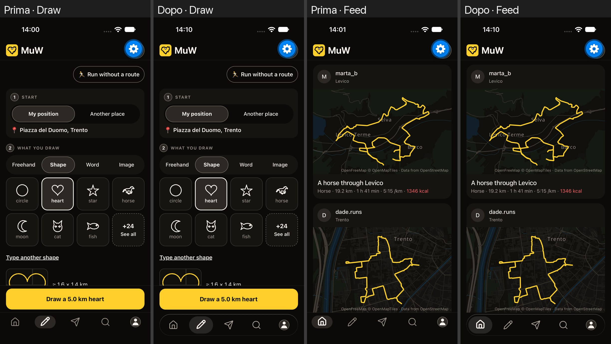

Con «Riduci trasparenza» la capsula è opaca (`surface`, letta al pixel:
22,20,17); con «Aumenta contrasto» opaca col bordo `borderStrong`:

**A2, i segmenti** — in tedesco (le parole più lunghe), la pillola che
scivola da una scelta all'altra in circa 160 ms senza superarla:

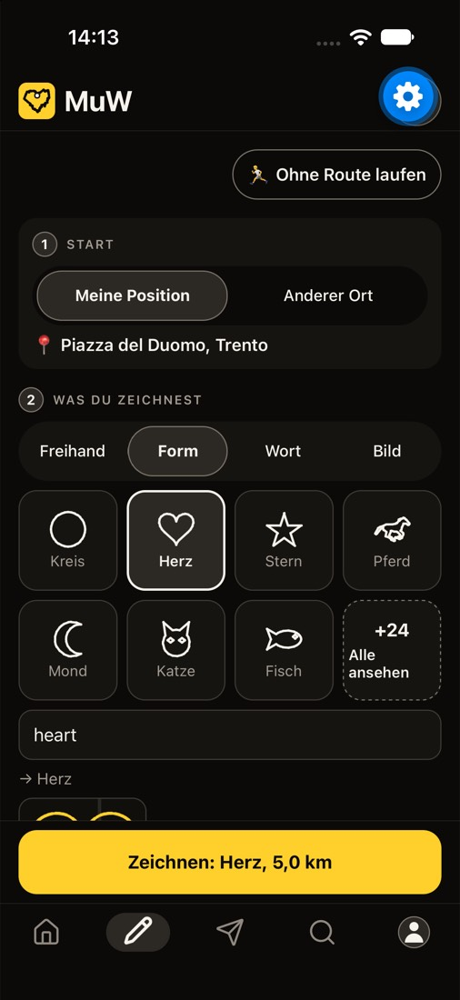
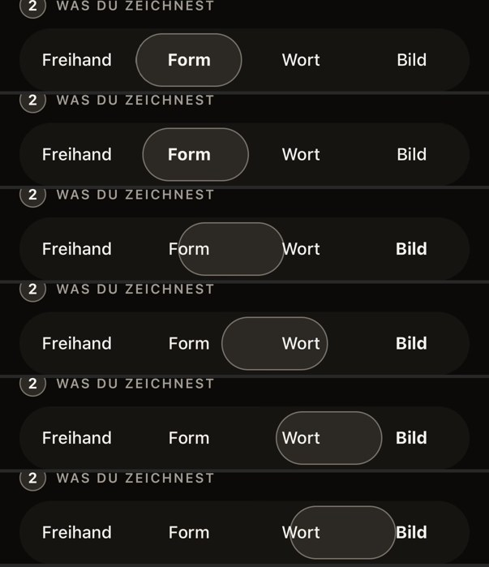

**A3, la pista e la pillola** — la pista ha un filo di luce sul bordo,
la pillola una luce in cima e un'ombra corta. L'effetto è sottile, più
visibile in scuro; Draw, Feed e Play:

Con «Riduci trasparenza» la pista è il fondo opaco come prima (11,10,8 al
pixel) e la barra `surface` (22,20,17):

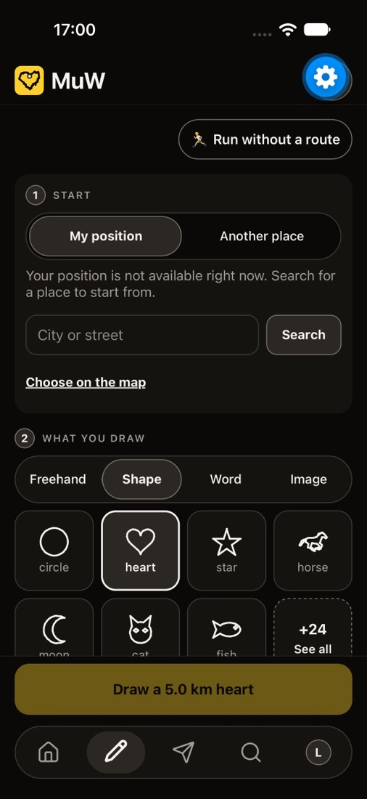

**A4a, i chip** — le città di Explore e i chip della ricerca hanno una
luce in cima e un'ombra corta; i colori restano, il giallo del chip
scelto compreso. In chiaro si nota di più il filo di luce sul chip nero
«Near me»:

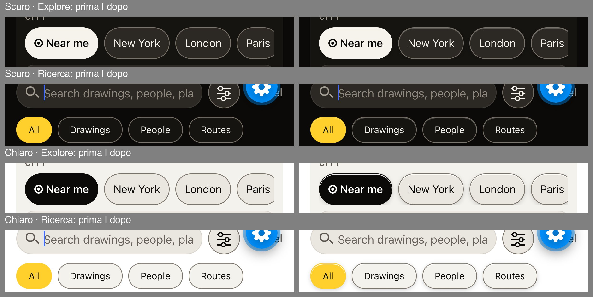

Con «Riduci trasparenza» i chip restano piatti e la barra è `surface`
(22,20,17 al pixel):

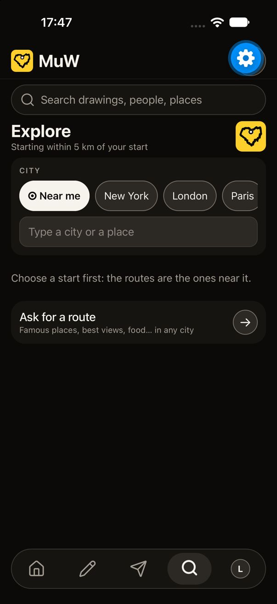

**A4b, le card di Explore** — angoli a 28 e un filo di vetro intorno
(netto in scuro, leggero in chiaro); la percentuale su una capsula di
vetro, sotto cui la linea gialla si intravede appena. Con «Riduci
trasparenza» la card è come prima, la barra `surface`:

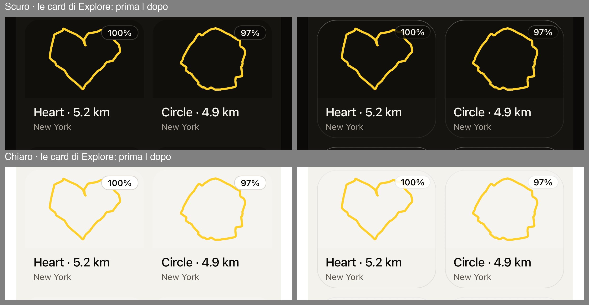
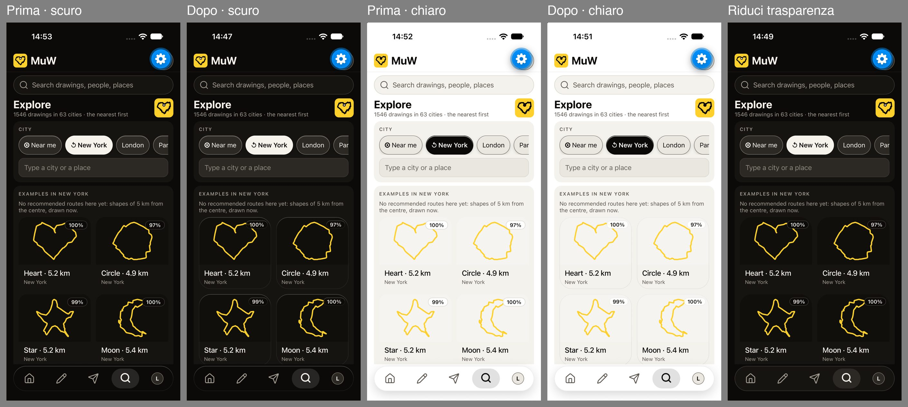

**A4c, le card del Feed** — prima il titolo bianco su `Scrim` spariva
sopra un cielo chiaro; ora sta su una capsula di vetro e si legge su
ogni foto, in tutti e due i toni. Sulla foto scura in tono chiaro i
puntini si intravedono appena attraverso la capsula. Con «Riduci
trasparenza» la capsula è opaca:

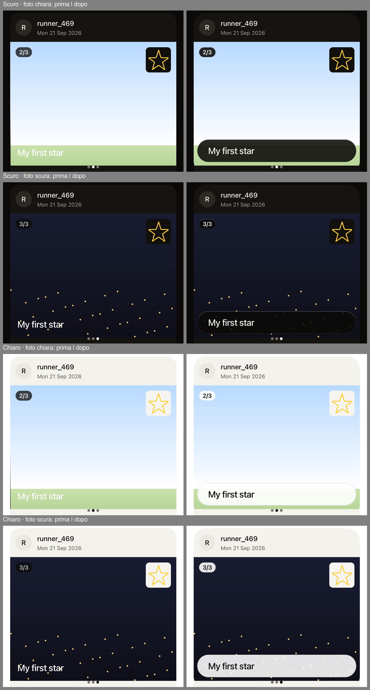

**A5, i cerchi dell'header** — prima la campanella era un'icona nuda e lo
sport un cerchio pieno; ora sono due cerchi di vetro in rilievo col bordo
forte. Con «Riduci trasparenza» sono opachi:

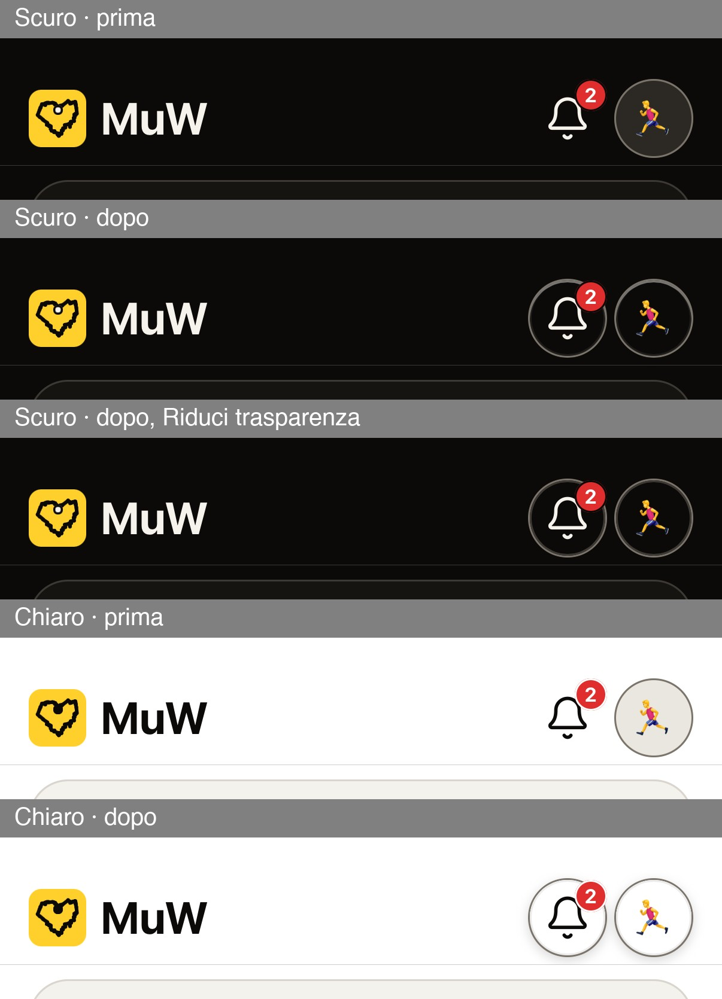

**A5b, l'header che cambia scorrendo** (Disegna) — prima la linea sotto
l'header c'era sempre; ora in cima non c'è, e compare con la fascia
quando la pagina scorre. In chiaro si vede l'ombra corta sul contenuto; in
scuro la fascia somiglia alla vecchia linea, e la differenza è la pagina
in cima senza linea. Con «Riduci trasparenza» la fascia è opaca, con la
linea sottile:

**A5c, il Profilo che scorre** — in cima l'header è a riposo, scorrendo
prende la fascia di vetro, come Disegna; scuro, chiaro e «Riduci
trasparenza» (fascia opaca):

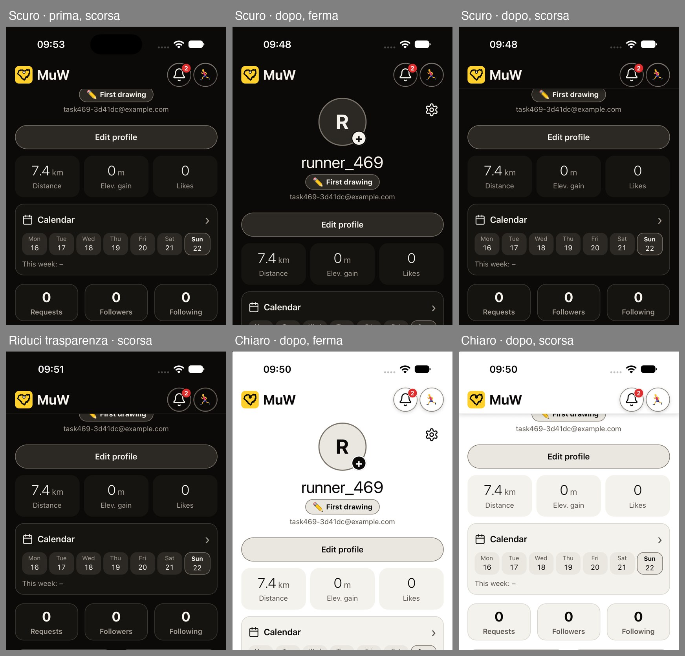

**A6, i gruppi di Impostazioni** — gli angoli passano da 16 a 24, quindi
un gruppo di una riga sembra quasi una capsula. In scuro il bordo è vicino
a quello di prima, in chiaro più morbido; le parole restano su `surface`.
Con «Riduci trasparenza» il bordo è la linea sottile di prima. La scheda
dell'account resta a 16 fino alla A6b:

**A6b, l'account e «Blocked people»** — la scheda dell'account prende un
bordo e gli angoli a 24 (prima non aveva bordo); «Blocked people», una
sola riga, diventa quasi una capsula. Il riquadro prima di «Delete
account» tiene il bordo rosso con gli angoli dei gruppi. Scuro, chiaro e
«Riduci trasparenza» (la linea sottile di prima):

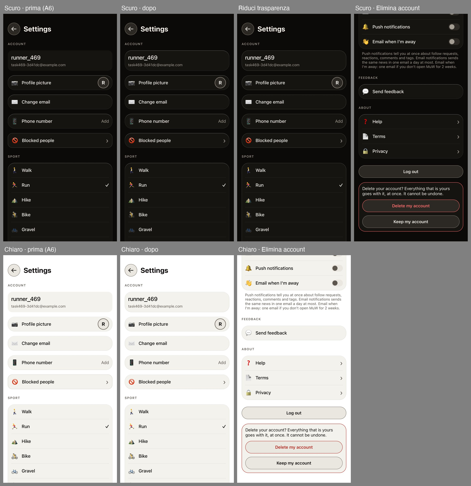

**A7a, i fogli dal basso** — gli angoli in alto passano da 26 (o 16) a 28,
la linea dura in cima diventa il filo di luce del vetro e un'ombra
morbida sale sul contenuto dietro: si vede in chiaro, appena in scuro.
«Share» del Feed, i filtri della ricerca, il «…» di un profilo, i
commenti e «Riduci trasparenza» (la linea sottile di prima):

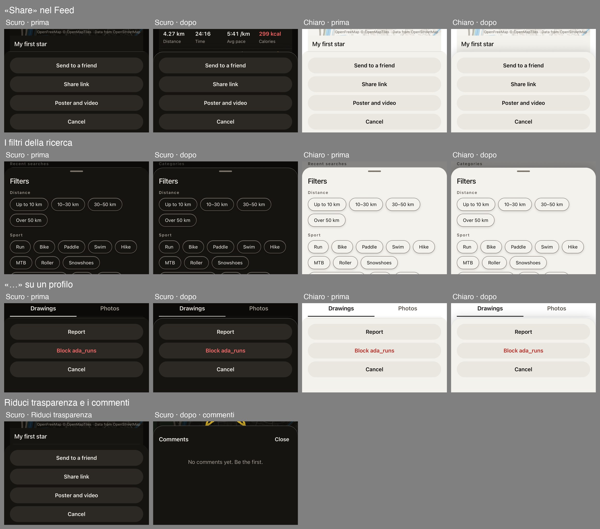

**A7b, l'isola** — dopo una segnalazione: in scuro un filo di luce
sottile intorno alla capsula, in chiaro un'ombra corta sotto:

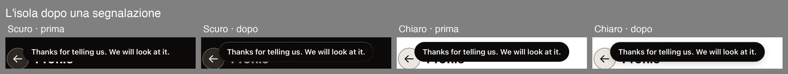

**A5c-2, il Feed che scorre** — prima l'header del Feed non cambiava mai;
ora in cima è a riposo, scorrendo prende la fascia di vetro, e passando a
una scheda in cima torna a riposo. Con «Riduci trasparenza» la fascia è
opaca:

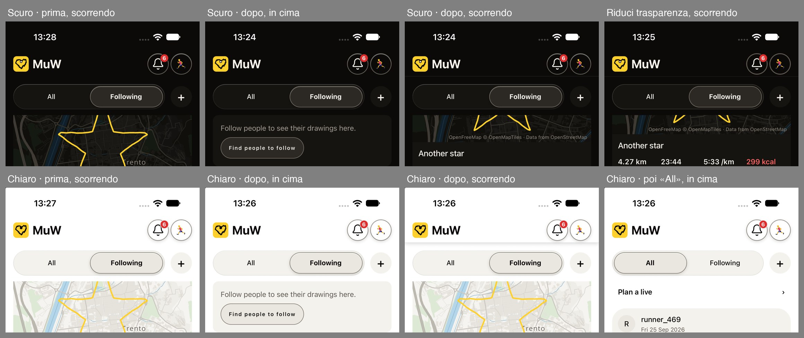

**A7c-1, i chip** — «Share your run» (Results e Music) e il foglio
«Photos only» (Tag people, Who can see it). In scuro cambia solo un filo
di luce in cima al chip; in chiaro il chip ha un'ombra corta sotto. Con
«Riduci trasparenza» è uguale a prima:

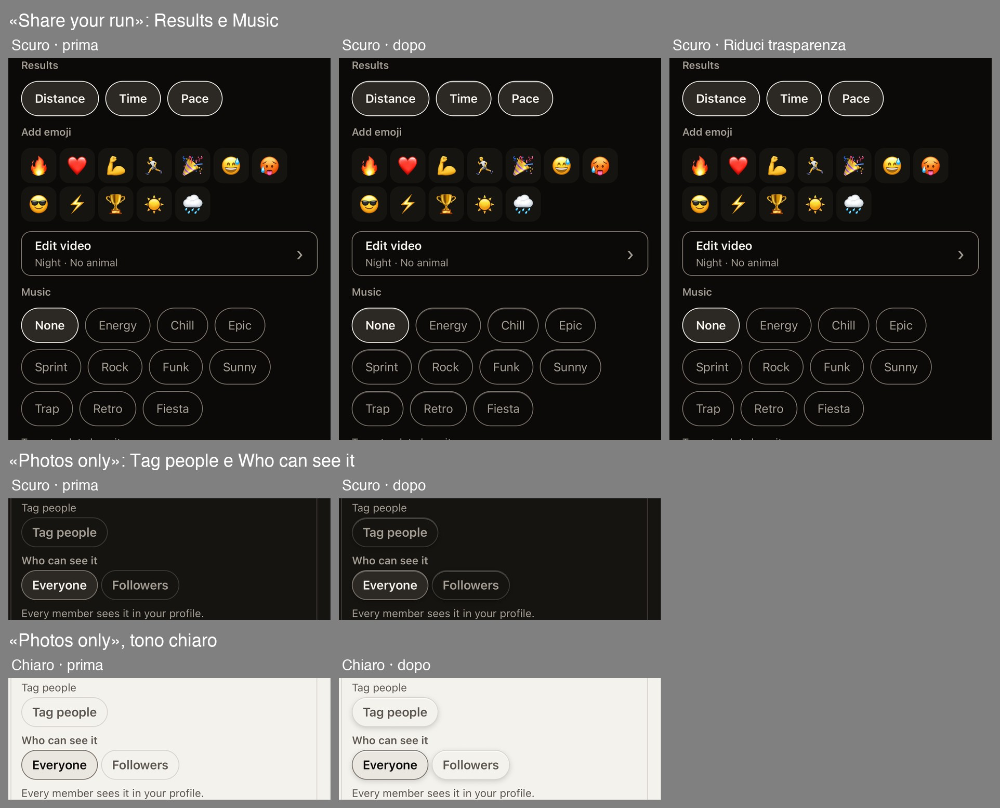

**A7c-2, i chip degli sport** — la lunghezza della vasca nel nuoto
(«Pool length»). Come in A7c-1: in scuro un filo di luce in cima al chip,
in chiaro un'ombra corta sotto; con «Riduci trasparenza» è uguale a
prima:

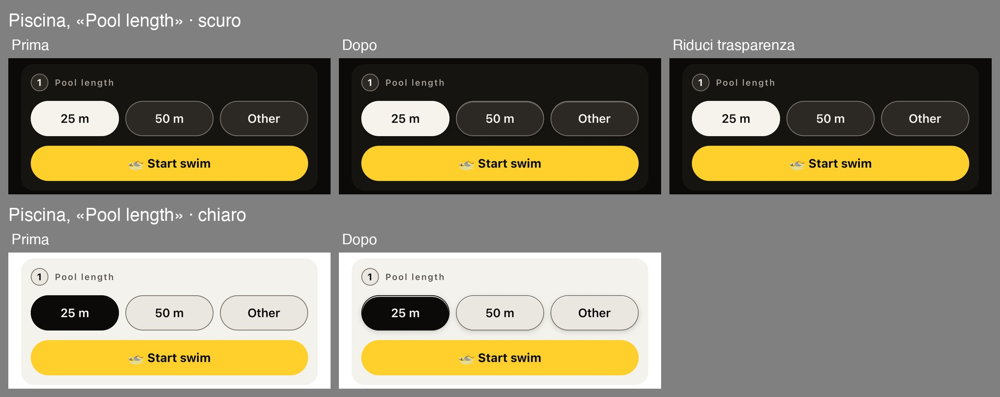

**A7c-3, i chip della palestra** — il pannello del riposo (0:30, 1:00,
1:30, 2:00, 3:00, Custom). Come gli altri chip: in scuro un filo di luce
in cima, in chiaro un'ombra corta sotto; con «Riduci trasparenza» è
uguale a prima. «−15 s», «+15 s» e «Skip» sono bottoni e non cambiano:

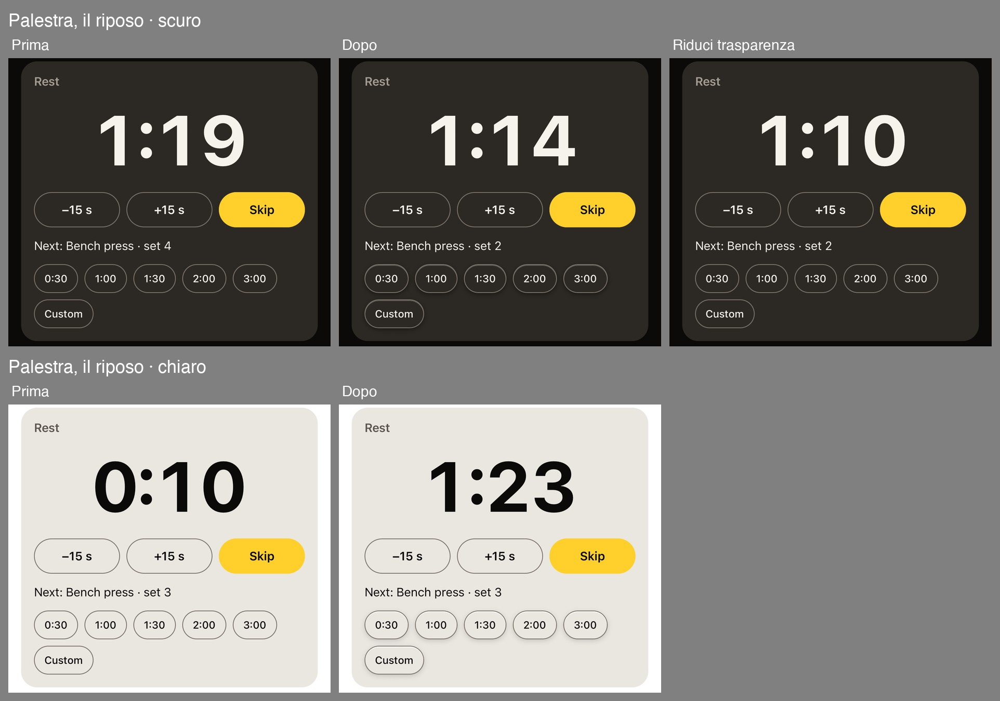

**La correzione dell'header sopra le pagine** — sopra com'era in
produzione dall'OTA 21, sotto con la correzione. Dalla scheda «Messages»
l'header copriva la riga del titolo della conversazione e di «Message
requests»; da un profilo era già a posto (la terza colonna, di
controllo):

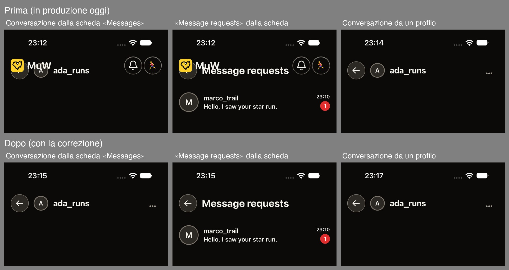

**B2, la barra in vetro vero** (bozza #1562, simulatore con iOS 27, Expo
Go) — in alto il Feed in scuro e in chiaro, con la mappa di un post
dietro la barra. Sotto, la barra da vicino coi numeri di un post dietro:
a sinistra il vetro velato di oggi se galleggiasse (la strada scartata),
a destra il vetro vero. In fondo il tono chiaro e «Riduci trasparenza»,
dove la barra è opaca:

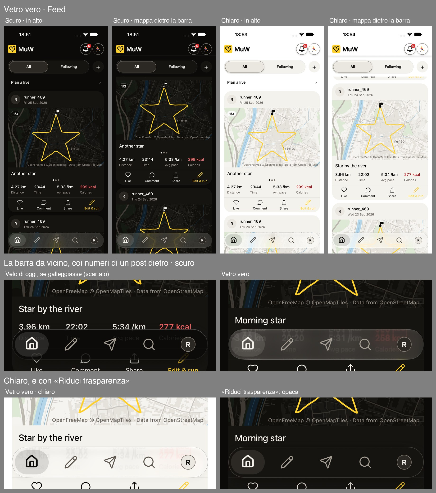

**A7c-4, i chip della schermata del volo** — nell'aspetto «Dark» e in
«Sunlight» (con l'app nel tono scuro: il rilievo è quello dell'aspetto
del volo, non del tono dell'app), e con «Riduci trasparenza», dove sono
piatti come prima:

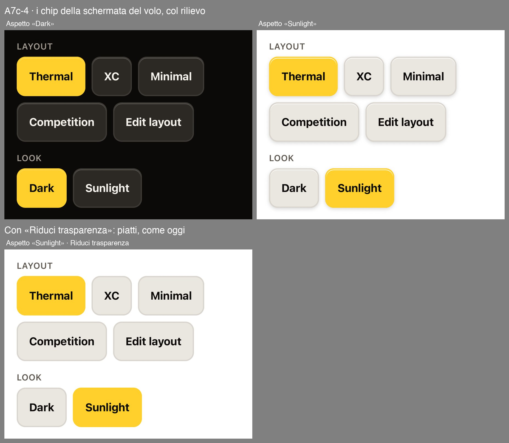

**La prova del vetro vero** (2026-11-26) — la barra nei due casi
peggiori, la prova della velatura, il foglio dei commenti, e quello che è
andato bene: l'header che galleggia con «Draw» che gli scorre dietro e il
foglio «Share». Le misure sono nelle didascalie:

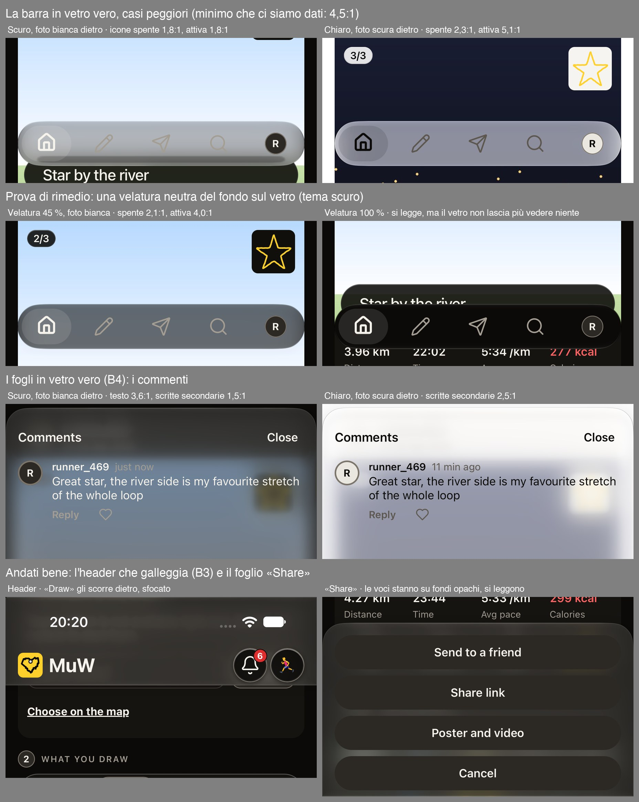

**Il vetro velato** (2026-11-27) — la barra nei due casi peggiori, con
accanto quella del giorno prima e quello che si vede ancora attraverso
sopra la mappa; sotto, il foglio dei commenti con la velatura della
barra:

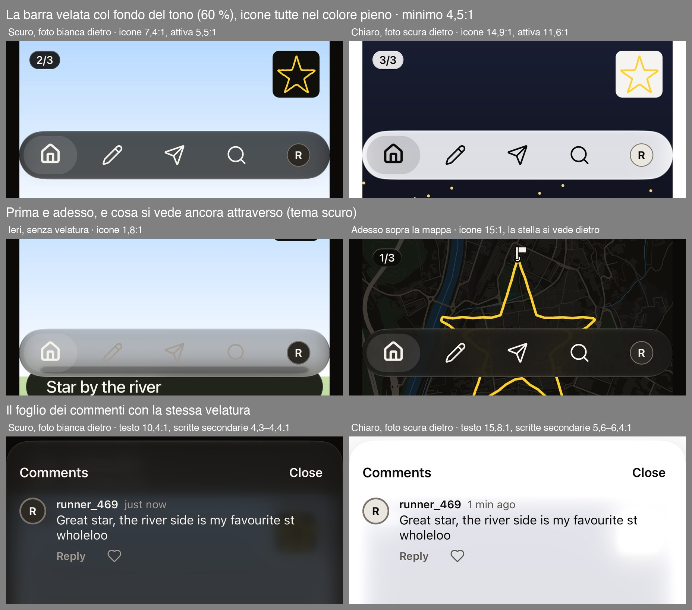

Il foglio dei commenti con la velatura dei fogli, «Riduci movimento»
prima della correzione (tono scuro) e dopo (tono chiaro), e l'header
velato nei due toni:

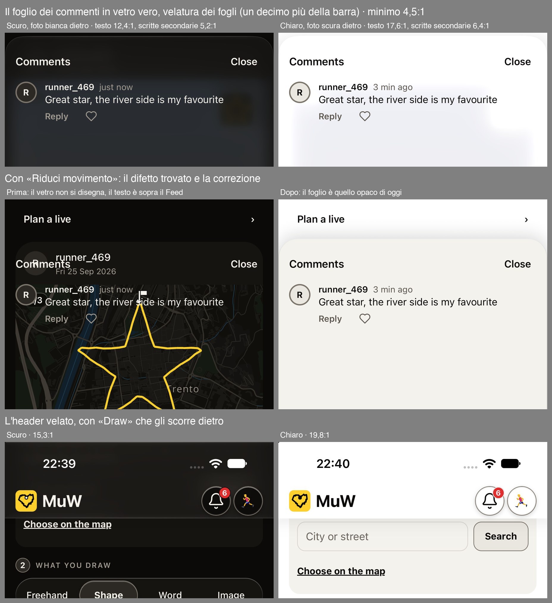

## Esito

*(a fine task)* — A1 e A2 in produzione dal 2026-11-12 (OTA 14); A3 e A4a
in `main` dal 2026-11-12, in produzione al più tardi con l'OTA 17
(2026-11-18); A4b e A4c in produzione con l'OTA 20 (2026-11-21); A5 e A5b
con l'OTA 21 (2026-11-22); A5c e A6 in produzione con l'OTA 22
(2026-11-22, b4c31f09); A6b con l'OTA 23 (2026-11-23, e427ed2e); A7a, A7b, A5c-2 e A7c-1 con l'OTA 24
(2026-11-23, 832dc598); A7c-2, A7c-3 e la correzione dell'header sopra le
pagine con l'OTA 25 (2026-11-24, b532fc17), provata dall'utente sul
telefono lo stesso giorno («Top funziona tutto»). La parte B è avviata
dal 2026-11-24: per ora solo il piano.
