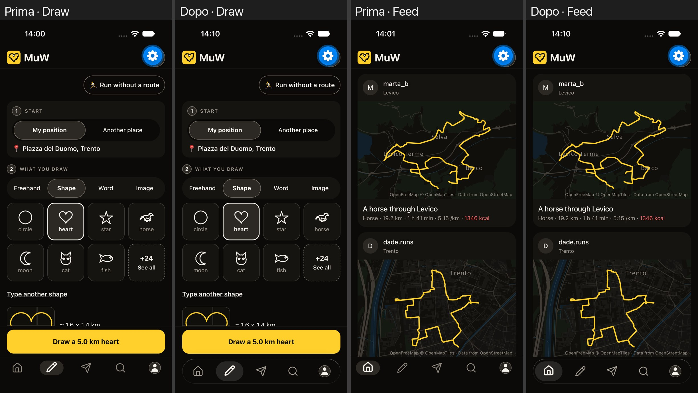
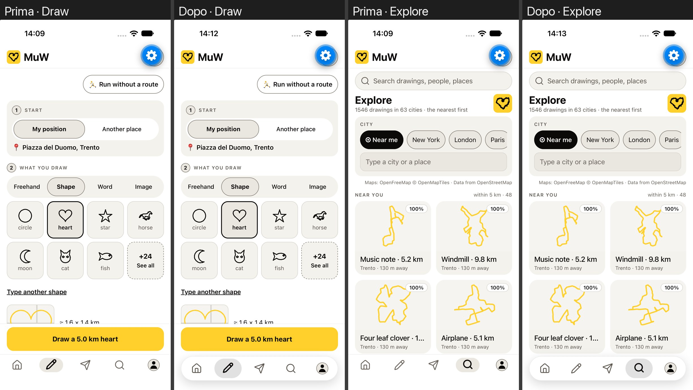
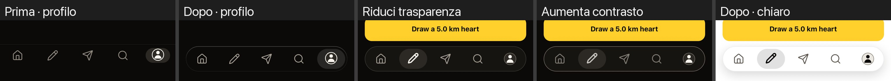
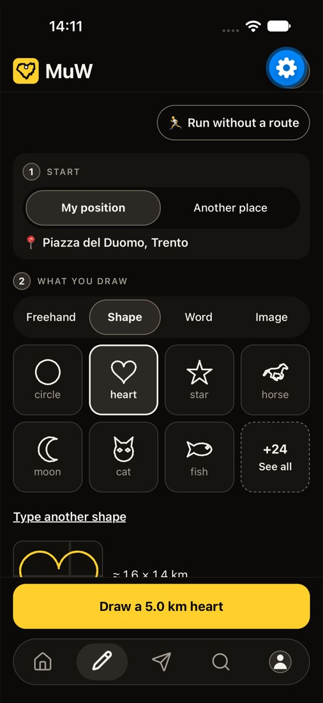
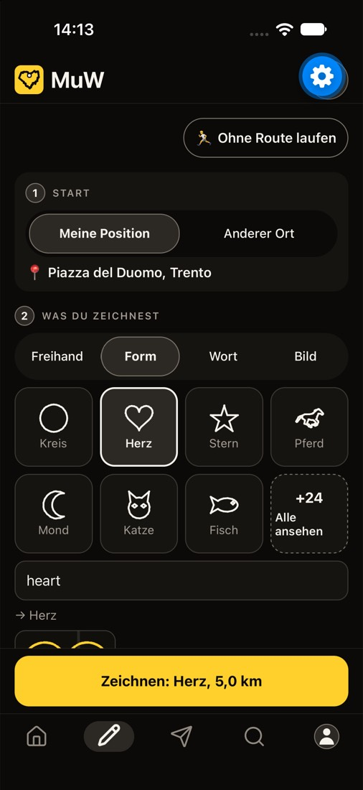
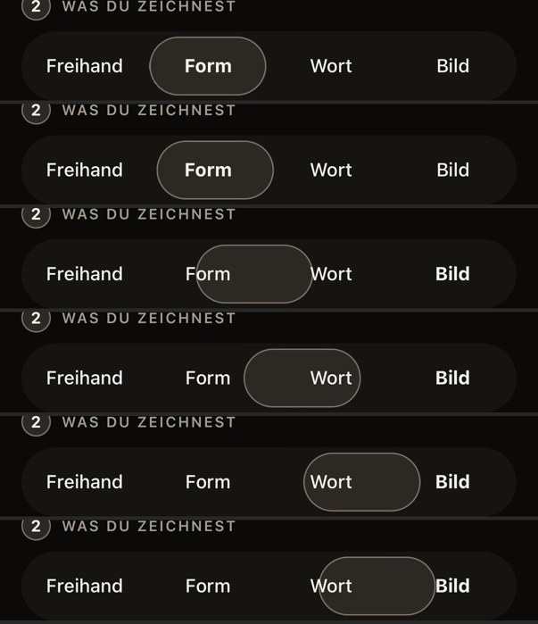
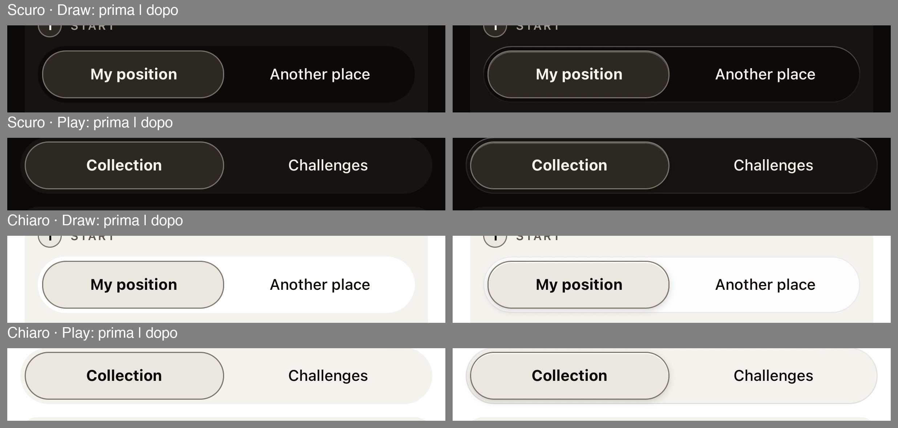
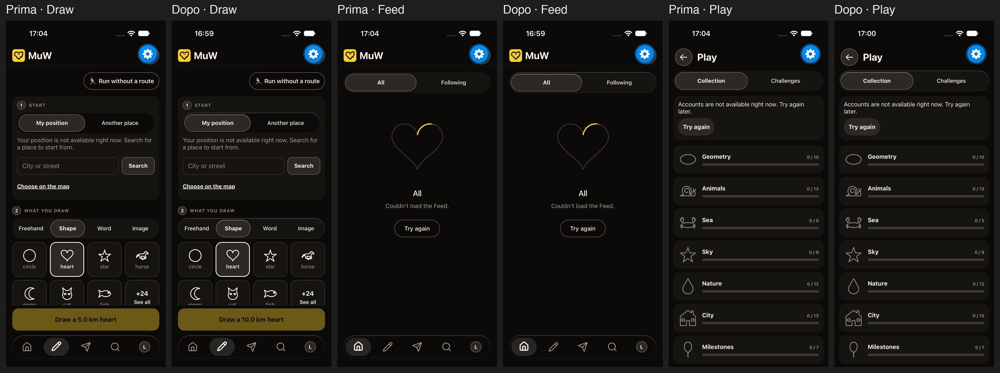
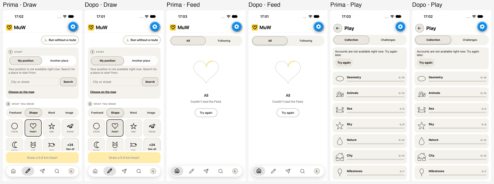
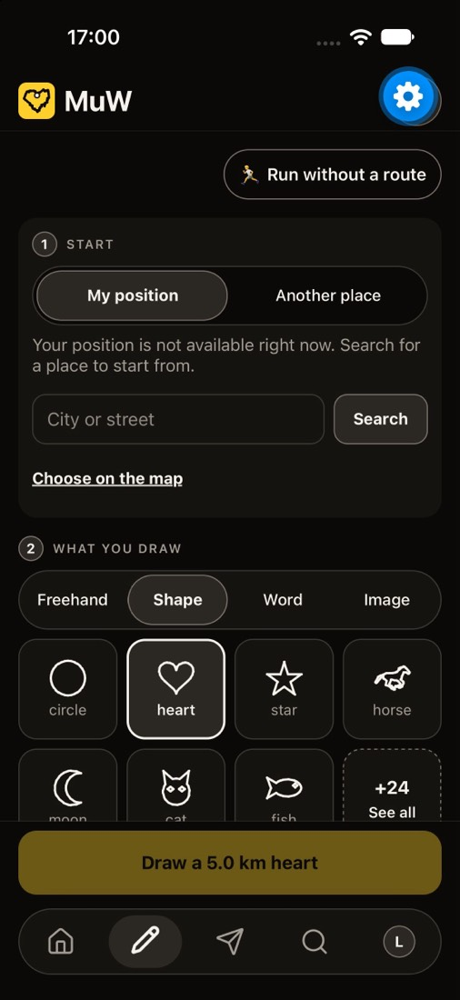

# TASK-469 — Il look Liquid Glass

**Stato**: In corso (0 fatta: «Capsula»; A1 e A2 in produzione con l'OTA 14;
A3 in `main`, esce col prossimo OTA; prossima la fetta dei chip)
**Fase**: 5 · **ADR**: ADR-0383 · **Branch**: una per fetta, da `main`
(`feat/TASK-469-a1-glass-bar` #1219, `feat/TASK-469-a2-sliding-segments`
#1225, `feat/TASK-469-a3-glass-segments` #1276; documenti
`docs/TASK-469-a-done` #1270, `docs/TASK-469-a3-done` questa)

## Obiettivo

L'app prende il look Liquid Glass di iOS 26: superfici traslucide con un
bordo di luce sottile, capsule che galleggiano, profondità e movimento
morbido. Si comincia dalla barra delle schede e dai segmenti, poi Explore,
Feed e Settings, poi il resto. Richiesta dell'utente del 2026-11-12.

## Contesto da leggere

- `docs/UI.md` «Il tema», «Il look premium» (TASK-339, ADR-0293), «Il
  movimento della barra», «L'isola», «Fogli e liste» (TASK-388, ADR-0329)
- `apps/mobile/src/theme/tokens.ts`
- Le direzioni visive: https://claude.ai/artifact/HD397UmJcu94vNZvGBH2bs
  (fonte in `out/liquid-glass/direzioni.html` nel checkout principale)

## Le parti

- **0 — La direzione** (scelta di prodotto, dell'utente). Tre direzioni
  sulla pagina sopra: **Capsula** (barra a capsula che galleggia, segmenti
  a pillola con indicatore che scivola, didascalie delle card su una lastra
  di vetro dentro la foto), **Lastra** (barra attaccata in basso con gli
  angoli alti arrotondati, card a due superfici, vetro solo su barra e
  header), **Luce** (profilo in un cerchio di vetro a parte, alone sulla
  scheda attiva, chip e righe di vetro staccate). **Scelta dell'utente
  (2026-11-12): «Capsula».**
- **A — Vetro senza dipendenze, via OTA**, in fette piccole, ognuna una PR
  da `main`, **dopo l'aggiornamento completo** e col sì del Coordinatore
  sulla lista dei file prima del codice:
  - **A1 fatta** (#1219, in `main` 6d360ca0): i token del vetro in
    `tokens.ts` (solo aggiunte: `GLASS_VEIL`, `glassOf`, `glass`),
    `src/ui/Glass.tsx` e `src/ui/useGlassMode.ts` (file nuovi), e la barra
    delle schede come capsula di vetro che galleggia (bordo di luce, ombra;
    icone spente da `textFaint` a `textMuted`). Le fette A1 e A2 della prima
    stesura sono diventate una sola;
  - **A2 fatta** (#1225, in `main` 24320b68): `Segmented` con la pillola che
    scivola alla scelta nuova;
  - **A3 fatta** (#1276, in `main` 666f67af): la pista dei segmenti di
    vetro e la pillola in rilievo, in `Segmented` e in `PlayTabs`.
    `FeedTabs` usa `Segmented` e prende tutto senza essere toccato;
    `ExploreTools` ha chip, non segmenti, e va con la fetta dei chip;
    `RoutePanel.tsx` non si tocca (di TASK-413 B) ma prende il vetro da
    `Segmented`;
  - A4 le card di Explore e Feed (superfici stratificate, raggi più grandi);
  - A5 l'header che si dissolve allo scroll (`AppHeader`);
  - A6 Settings (dopo TASK-457, che tiene `src/profile/**`);
  - A7 il resto (fogli, isola, chip), da elencare dopo A6.
- **B — Liquid Glass nativo** con `expo-glass-effect` (UIGlassEffect su
  iOS 26; `expo-blur` o opaco prima e su Android). Dipendenza nuova e
  impronta iOS che cambia: solo in una build **dopo l'uscita della 1.1.0**,
  col sì dell'utente e chiedendo prima al Coordinatore. Prima di installare
  qualcosa ci si ferma e si chiede.

## Inventario delle superfici

| Superficie | File | Oggi | Con il vetro | Libero? |
|---|---|---|---|---|
| Barra delle schede | `src/tabs/TabBar.tsx` | `background` al 95%, filo in cima, capsula `surfaceRaised` che scivola | **fatto (A1)**: capsula di vetro, bordo di luce, ombra morbida | sì; letto dai test di quasi ogni schermata (con `TabShell.tsx`, `TabSwipeOwners.test.ts`) |
| Header | `src/tabs/AppHeader.tsx` | pieno, logo e pulsanti | si dissolve in vetro allo scroll; pulsanti in cerchi di vetro | sì |
| Isola | `src/ui/Island.tsx`, `IslandLayer.tsx` | capsula scura | capsula di vetro scuro | sì |
| Fogli dal basso | `src/ui/SheetModal.tsx` | `surface` pieno | vetro con bordo di luce, angoli 28 | sì |
| Segmenti | `src/screens/Segmented.tsx`, `src/feed/FeedTabs.tsx`, `src/explore/ExploreTools.tsx`, `src/game/PlayTabs.tsx` | pillola su `background` | pillola di vetro, indicatore in rilievo che scivola (**`Segmented` fatto, A2**) | sì |
| Chip dei filtri | `src/search/FilterChip.tsx` | — | chip di vetro | sì |
| Card di Explore | `src/explore/RouteCard.tsx`, `ThemedCard.tsx`, `ExploredCard.tsx` | raggio `xl` 20, senza bordo | raggio 28, didascalia su vetro | sì |
| Pagina Explore | `src/explore/ExploreScreen.tsx` | — | solo se serve lo scroll per l'header | **TASK-441** |
| Card del Feed | `src/feed/FeedPost.tsx`, `MuwPost.tsx`, `StylePost.tsx` | raggio `xl`, `Scrim` sulla foto | didascalia su vetro al posto di `Scrim` | sì |
| Azioni del post | `src/feed/PostActions.tsx` | — | non si tocca | **TASK-454** |
| Settings | `src/profile/SettingsPage.tsx`, `src/settings/*` | righe con `Hairline` | gruppi a raggio 24 sotto header e barra di vetro | `profile/**` è di **TASK-457** |
| Colori | `src/theme/tokens.ts` | — | token nuovi: tinta, velatura, bordo di luce (alto e basso), ombra, per tono e passo | sì, **solo aggiunte** |
| `App.tsx` | — | — | non serve | a turno, ora di TASK-457 |

Nell'app non ci sono `expo-blur` né `expo-glass-effect`. React Native 0.86
ha già ombre (`boxShadow`, anche interne), sfumature e bordi di colore
diverso per lato: la parte A non chiede niente di nativo.

## Vincoli

1. **Colori** solo da `tokens.ts`. I valori esistenti, `warning` compreso,
   non si toccano: si aggiungono token. Il giallo resta al percorso e al suo
   comando, mai come tinta del vetro.
2. **Contrasto**: sull'App Store sono dichiarati «Sufficient Contrast» e il
   tema scuro. Testo e icone sul vetro restano ≥ 4,5:1 sul caso peggiore
   (foto bianca sotto il tono scuro, nera sotto il chiaro), a ogni passo di
   luminosità; un test lo controlla come `palettes.test.ts`. Senza blur
   questo vuol dire una velatura di circa 86–92%: il vetro si intravede
   appena; la trasparenza vera arriva con B.
3. **Accessibilità di iOS**: con «Riduci trasparenza»
   (`AccessibilityInfo.isReduceTransparencyEnabled`) le superfici diventano
   opache; con «Aumenta contrasto» (`isDarkerSystemColorsEnabled`) opache
   col bordo `borderStrong`; con «Riduci movimento» niente animazioni, solo
   dissolvenze brevi (come TASK-388).
4. **Prestazioni**: niente blur sopra la mappa mentre si registra.
5. **Impronta iOS**: la parte A non deve muovere `6f8bba4c`.
6. **Simulatore** a turni dati dal Coordinatore (coda dell'11-12: 457 →
   415 B3 → 461 A2 → 466 B).

## Criteri di accettazione (ogni fetta di A)

Spuntati per A1 e A2 (2026-11-12):

- [x] Test deterministici dei componenti toccati, verdi; `tsc` verde.
- [x] Il test del contrasto sul vetro passa per ogni tono e passo
      (`theme/glass.test.ts`).
- [x] «Riduci trasparenza», «Aumenta contrasto» e «Riduci movimento» hanno
      un test ciascuno (`TabBarGlass.test.tsx`, `Segmented.test.tsx`).
- [x] L'impronta iOS resta `6f8bba4c` (nessun file nativo, nessuna
      dipendenza; uscite con l'OTA 14).
- [x] Schermate prima/dopo in chiaro e scuro qui sotto.
- [x] Decisione in `DECISIONS.md` (ADR-0383) e `docs/UI.md` aggiornato,
      nella PR di soli documenti dopo il merge (questa).

## File toccati

- A1 (#1219): `apps/mobile/src/theme/tokens.ts` (solo aggiunte),
  `src/theme/glass.test.ts`, `src/ui/Glass.tsx`, `src/ui/Glass.test.tsx`,
  `src/ui/useGlassMode.ts`, `src/ui/useGlassMode.test.ts` (nuovi),
  `src/tabs/TabBar.tsx`, `src/tabs/TabBarGlass.test.tsx` (nuovo),
  `src/tabs/TabBarMotion.test.tsx`, `src/tabs/TabShellDrag.test.tsx` (una
  riga, col sì del Coordinatore).
- A2 (#1225): `apps/mobile/src/screens/Segmented.tsx`,
  `src/screens/Segmented.test.tsx` (nuovo).
- A3 (#1276): `apps/mobile/src/screens/Segmented.tsx`,
  `src/game/PlayTabs.tsx`, `src/screens/SegmentedGlass.test.tsx` (nuovo).
- La PR di documenti di A3: `docs/tasks/TASK-469.md`,
  `docs/tasks/TASK-469/*-A3-*.jpg`, `a3-*.jpg` (nuove), `docs/STATUS.md`,
  `docs/DECISIONS.md`, `docs/UI.md`.
- La PR di documenti di A1 e A2: `docs/tasks/TASK-469.md`, `docs/tasks/TASK-469/*.jpg`
  (nuove), `docs/STATUS.md`, `docs/DECISIONS.md`, `docs/UI.md`.

La lista di ogni fetta seguente va al Coordinatore prima del codice.

## Fuori scope

- Cambiare i colori esistenti, il giallo, la mappa, la linea del percorso.
- La parte B prima della 1.1.0 e del sì dell'utente.
- File di altri task in lavorazione (`profile/**`, `ExploreScreen.tsx`,
  `PostActions.tsx`, `App.tsx`).
- Un tono «di sistema» che segue il telefono (UI.md, scelta ancora aperta).

## Cronologia

- **2026-11-12**: numeri dal Coordinatore (TASK-469, ADR-0383); tre
  direzioni pubblicate; l'utente sceglie «Capsula» (ADR-0383). A1 parte
  da `main` dopo l'aggiornamento completo, col sì del Coordinatore sulla
  lista dei file.
- **2026-11-12**: A1 (#1219) e A2 (#1225) scritte; turno di simulatore
  (prima = `origin/main`, dopo = i due branch; tono e lingua forzati con
  modifiche locali non committate, poi tolte); l'utente approva le
  schermate («Sì, tutte e due»). #1219 in `main` 6d360ca0, #1225 in `main`
  24320b68; **in produzione con l'OTA 14** (15:15Z, be21e7d8).
- Imparato: senza blur il vetro si riconosce dal bordo di luce e
  dall'ombra, non dalla trasparenza: la fascia sotto la barra resta
  opaca e il contenuto non le passa sotto. La capsula ora ha margine a
  destra: prima la pillola del profilo toccava il bordo.
- **2026-11-12**: A3 (#1276): lista dei file col sì del Coordinatore,
  codice, turno di simulatore (prima = i due file di `main` rimessi per un
  momento nel worktree, dopo = il branch); l'utente approva le schermate
  («Sì, vai»). #1276 in `main` 666f67af, esce col prossimo OTA.
- Imparato: il simulatore può restare sullo sport di un'altra sessione;
  per Draw e Play si torna a «Run» da Settings. Metro in modo CI non
  ricarica: una variante, un riavvio.

## Schermate prima/dopo

Simulatore iPhone, 2026-11-12. Prima = `origin/main`, dopo = le PR.

**A1, la barra** — scuro e chiaro, Feed, Draw, Explore:

Con «Riduci trasparenza» la capsula è opaca (`surface`, letta al pixel:
22,20,17); con «Aumenta contrasto» opaca col bordo `borderStrong`:

**A2, i segmenti** — in tedesco (le parole più lunghe), la pillola che
scivola da una scelta all'altra in circa 160 ms senza superarla:

**A3, la pista e la pillola** — la pista ha un filo di luce sul bordo,
la pillola una luce in cima e un'ombra corta. L'effetto è sottile, più
visibile in scuro; Draw, Feed e Play:

Con «Riduci trasparenza» la pista è il fondo opaco come prima (11,10,8 al
pixel) e la barra `surface` (22,20,17):

## Esito

*(a fine task)* — A1 e A2 in produzione dal 2026-11-12 (OTA 14); A3 in
`main` dal 2026-11-12, col prossimo OTA.
